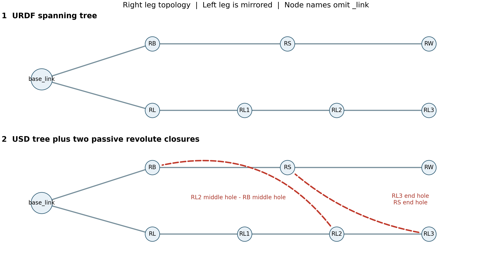

# Isaac Sim 五连杆开链转闭链实操教程

适用软件：本机 Isaac Sim 5.1.0。练习对象：你导入的 `mine_robot` 新车模型。按下面的步骤操作，从只有树形连接的 URDF，制作带四个闭合铰链的 USD，并检查它是否正确闭合。

完成后，你应能独立做四件事：找出一个关节连接的两个刚体；给两根连杆添加转动铰链；选择哪些关节进入 Articulation 树；用小幅驱动检验闭链，而不是靠训练结果猜模型对不对。

所有练习保存到 `mine_model/tutorial_work/closed_chain_v4`。不要覆盖训练资产、`manifest.json` 或源 CAD。文中的结构图是连接关系示意，不是软件界面截图。

## 1 准备输入文件和练习目录

1. 打开终端，执行下面两行，建立独立练习目录。

```bash
cd /home/aaa/studyRL/src/CLT-RL
mkdir -p mine_model/tutorial_work/closed_chain_v4
```

2. 在文件管理器中打开下面的目录，确认有 `mine_robot.urdf` 和 `meshes` 文件夹。

```text
/home/aaa/studyRL/src/CLT-RL/mine_model/exports/
export_20261003_181515/
```

3. 这次导入 **这个目录里的 `mine_robot.urdf`**。它是开链的，尚未包含四个闭合关节，但机身坐标已经统一成 X 前、Y 左、Z 上。原始 `source/robot.urdf` 使用另一套 CAD 坐标，不能和本教程的局部参数表混用。
4. 保持 `meshes` 与这个 URDF 的相对位置不变。不要把 URDF 单独复制走，再让导入器寻找不存在的网格。
5. 另准备一个只读参照：同一目录中的 `mine_closed_chain.usd`。遇到字段看不懂时可以打开它对照；不要在它上面直接练习。

**检查点：** 输入文件名是 `mine_robot.urdf`，不是已闭合的 `mine_closed_chain.usd`；练习输出目录与现有训练模型目录不同。

## 2 启动软件并打开操作窗口

1. 在终端执行下面的命令。等待主界面、Viewport 和 Stage 都加载出来，再继续。

```bash
cd /home/aaa/studyRL/src/CLT-RL/isaacsim-5.1.0
./isaac-sim.sh
```

2. 如果当前打开了其他场景，先保存你自己的工作，再点击 `File > New` 新建空场景。
3. 保持时间轴在 **Stop** 状态。编辑关节前不要点 Play；Pause 只是暂停当前运动，不一定恢复装配初始姿态。
4. 如果右侧没有 Stage 或 Property 窗口，在 `Window` 菜单中找到并打开它们。接下来：在 Stage 中选对象，在 Property 中改字段。
5. 点击 `Window > Extensions`，搜索 `isaacsim.asset.importer.urdf`。如果它没有启用，开启它，再关闭扩展窗口。
6. 点击 `Window > Script Editor` 打开脚本编辑器，后面用它运行只读检查。不需要在系统 Python 终端里导入 `omni`。

导入入口和扩展名称见 [Isaac Sim 5.1 URDF 导入教程](https://docs.isaacsim.omniverse.nvidia.com/5.1.0/importer_exporter/import_urdf.html)。

**检查点：** Stage、Property、Viewport、Script Editor 可用；时间轴未运行。

## 3 导入开链模型并保存第一份检查点

1. 点击 `File > Import`。
2. 在文件选择器中进入第 1 节的导出目录，选择 `mine_robot.urdf`，确认后进入 URDF 导入设置。
3. 展开设置项，按下表配置。不同面板布局可能把高级选项放在折叠区域内；不要用肉眼相似的其他选项代替。

| 导入项 | 本次填写或选择 | 要达到的效果 |
| --- | --- | --- |
| USD Output | 第 1 节练习目录；输出名用 `00_imported.usd` | 不覆盖正式资产；有的界面只选目录，实际文件名以导入完成后显示的路径为准 |
| Base | `Moveable Base` | 先生成可自由运动的机器人资产；后面另外做固定机身试验场景 |
| Merge Fixed Joints | 关闭，若该选项可见 | 保留当前 link 划分，不在练习中合并刚体 |
| Joint Drive Type | 所有关节选 `None` | 先只建立机构，不让默认 PD 拉动被动杆 |
| Allow Self-Collision | 关闭 | 第一次只检查闭链约束，避免自碰撞同时干扰 |
| Import Inertia Tensor | 开启，若该选项可见 | 使用 URDF 的惯量，不重新按外形推算 |
| Default Density | 留空或保持使用 URDF 质量的默认值 | 不用密度覆盖已提供的质量 |
| Distance Scale | `1`，若该选项可见 | URDF 中的长度已经是米，不再乘 1000 或 0.001 |

4. 点击 `Import`，等待导入结束。如果弹出是否直接打开生成文件的选择，选择打开生成的机器人 USD。
5. 如果机器人只是以 Reference 加入了当前空场景，选中机器人，查看 Property 中的 `References`，记下它实际指向的 USD。点击 `File > Open`，直接打开该文件，再编辑；不要只改空场景里的临时引用。
6. 在 Stage 里找到机器人容器。以下示例用 `/mine_robot`；若你的入口是 `/World/mine_robot`，所有 Body 路径都要加上相同的 `/World` 前缀，不能逐项混用。
7. 选中机器人容器，在 Viewport 按 `F` 聚焦模型。若没有网格，先查导入错误和 `meshes` 路径，不要继续加关节。
8. 点击 `File > Save As`，在同一练习目录保存 `01_open_chain.usda`。后续检查点也留在这里，保留导入器生成的 `configuration` 等依赖文件夹。

位置或速度 PD 不是闭链建模的必需条件。力矩控制关节在导入时选 `None` 的用法见 [URDF Importer 设置](https://docs.isaacsim.omniverse.nvidia.com/5.1.0/importer_exporter/ext_isaacsim_asset_importer_urdf.html)。

**检查点：** 模型外观完整；机身没有被固定到世界；尚未添加四个 closure；源 URDF 与原训练 USD 没有被覆盖。

## 4 在 Stage 中找出真正的刚体和关节

1. 展开 `/mine_robot`。先选 `base_link`，再看 Property 是否有 `Rigid Body`。这是刚体节点，不是其中一块 STL 网格。
2. 展开 `base_link` 下的视觉或碰撞对象，观察区别。带 `Mesh`、`visuals`、`collisions` 的子节点通常不是关节应该引用的 Body。
3. 逐一找到以下 15 个刚体。这里每个名字表示一个装配刚体，不是一个电机。

```text
base_link
LB_link  LS_link  LW_link
LL_link  LL1_link LL2_link LL3_link
RB_link  RS_link  RW_link
RL_link  RL1_link RL2_link RL3_link
```

4. 找到保存原有关节的 `joints` 区域，选择 `RL_joint`。在 Property 展开 `Physics > Joint`，核对 `Body 0` 与 `Body 1`。
5. 接着选择其他三个主动腿关节，按下表逐一核对。**四个主动腿电机都是相对机身的髋部输入，不能把第二个电机接成第一个电机后面的膝关节。**

| 关节 | Body 0 | Body 1 |
| --- | --- | --- |
| `LB_joint` | `/mine_robot/base_link` | `/mine_robot/LB_link` |
| `LL_joint` | `/mine_robot/base_link` | `/mine_robot/LL_link` |
| `RB_joint` | `/mine_robot/base_link` | `/mine_robot/RB_link` |
| `RL_joint` | `/mine_robot/base_link` | `/mine_robot/RL_link` |

6. 如果需要修正 Body：点击该关系字段的目标选择按钮，选择上表对应的 **刚体 Xform**，删除错误目标，使该字段只剩一个正确路径。修改 Body 后必须重新检查两侧局部关节坐标；不能只换路径而保留不匹配的坐标。
7. 本次指定的 URDF 本来就采用上表关系。如果检查正确，**不要改它们，也不要拖动刚体来“修树”**。

原始物理树应是下面这个结构。通过 `Body 0/1` 的关系沿树检查，不要求 Stage 的文件夹也嵌套成这个样子。

```text
base_link
|-- LB_joint --> LB_link
|   `-- LS_joint --> LS_link
|       `-- LW_joint --> LW_link
|-- LL_joint --> LL_link
|   `-- LL1_joint --> LL1_link
|       `-- LL2_joint --> LL2_link
|           `-- LL3_joint --> LL3_link
|-- RB_joint --> RB_link
|   `-- RS_joint --> RS_link
|       `-- RW_joint --> RW_link
`-- RL_joint --> RL_link
    `-- RL1_joint --> RL1_link
        `-- RL2_joint --> RL2_link
            `-- RL3_joint --> RL3_link
```

**检查点：** 15 个刚体、14 个树内转动关节；四个主动腿关节的 Body 0 都是 `base_link`。文件夹里把关节放在哪里，不会自动改变它连接的两个刚体。

## 5 先确认四处需要闭合的机械铰点

1. 从右腿开始，在 Stage 中依次选 `RL2_link`、`RB_link`，用 `F` 和滚轮放大相应杆件。
2. 根据连杆实体和 CAD 装配，辨认这两个刚体上应使用同一根销轴连接的孔。下一节创建 `RL2_RB_closure` 把它们连接起来。
3. 再找到 `RL3_link` 与 `RS_link` 的共同铰点。它对应 `RL3_RS_closure`。
4. 左腿按下表寻找另外两处。不要把“看起来最近的两个点”当作真实铰点。

| 要新建的闭合关节 | Body 0 | Body 1 | 连接位置 |
| --- | --- | --- | --- |
| `RL2_RB_closure` | `RL2_link` | `RB_link` | 右侧中间铰点 |
| `RL3_RS_closure` | `RL3_link` | `RS_link` | 右侧末端铰点 |
| `LL2_LB_closure` | `LL2_link` | `LB_link` | 左侧中间铰点 |
| `LL3_LS_closure` | `LL3_link` | `LS_link` | 左侧末端铰点 |



图中虚线表示补加的物理约束；左右布局和名称对照上表。图的位置不是毫米坐标，不要从这张示意图量关节坐标。

**检查点：** 你能在实体模型上指出四个铰点，以及每个铰点要连接的两根杆；当前没有把两根杆合并成同一个刚体。

## 6 弄清楚要填写的坐标和旋转

在 Joint 面板中，`Local Position 0` 是铰点相对 Body 0 坐标系的位置；`Local Position 1` 是同一个铰点相对 Body 1 的位置。因此，两组数字通常不相同。它们换算到世界坐标后，必须落在同一点。

`Local Rotation 0/1` 定义两侧关节坐标系的朝向；`Axis` 选的是这个 **关节局部坐标系** 的 X、Y 或 Z。这里采用 Axis=Z，借助 Local Rotation 把它对齐到实际销轴，不是让销轴沿世界竖直方向。

1. 保持时间轴 Stop，且连杆仍在导入时的初始装配姿态。不要先手工拉伸、旋转某根杆。
2. 选任意一个原始 Revolute Joint，找到 Physics 下的 `Local Position 0/1`、`Local Rotation 0/1` 和 `Axis`，熟悉它们所在位置。
3. 展开 XYZ 字段。普通 Joint 面板的 Local Rotation 使用三个欧拉角，单位为度；底层 USD `physics:localRot0/1` 存的是四元数。**不要把四元数的四个分量填进三个角度框。**
4. 下一节给你的参数全部是：位置单位 **米**，旋转单位 **度**。按 XYZ 顺序分别输入。
5. 如果软件界面显示的是四分量 Raw USD 四元数，而不是三个角度框，回到普通 Physics Joint 面板操作；或者用第 9 节的检查器打印 `local_rot*_xyz_deg`，不要自行猜分量顺序。

关节两侧局部坐标的含义见 [Omni Physics Joint Frames](https://docs.omniverse.nvidia.com/kit/docs/omni_physics/107.3/dev_guide/rigid_bodies_articulations/joints.html#joint-frames)。本教程参数表针对第 1 节指定 URDF 的刚体局部坐标。

**检查点：** 你要改的是 Physics Joint 的 Local 字段，而不是节点最上面的 Transform Translate/Rotate；不是把 CAD 毫米世界坐标直接贴到 Local Position。

## 7 手工添加第一个闭合关节

下面完整做一次 `RL2_RB_closure`。先只做这一个，核对成功后再重复。

### 7.1 选择两个刚体并创建转动关节

1. 在 Stage 中单击 `RL2_link` 的刚体节点。
2. 按住 `Ctrl`，再单击 `RB_link` 的刚体节点。确认这两个节点同时高亮，未选中它们内部的 Mesh。
3. 在高亮节点上右键，点击 `Create > Physics > Joint > Revolute Joint`。有些文档把中间菜单写为 `Joints`；本机 5.1 的菜单源码名称为 `Joint`。
4. Stage 会新增 `RevoluteJoint`。选中它，用右键 `Rename` 或 `F2` 改名为 `RL2_RB_closure`。
5. 再看 Property 的 Body 字段，**以字段为准，不以创建时的点击顺序猜结果**。把 Body 0 设置为 `/mine_robot/RL2_link`，Body 1 设置为 `/mine_robot/RB_link`。
6. 如果希望整理文件夹，在 `/mine_robot` 下右键 `Create > Scope`，命名为 `loop_joints`，把新建的 **Joint 节点** 移入它。再次核对 Body 路径；不要移动刚体。

双选刚体创建 Revolute Joint 的操作见 [Isaac Sim 5.1 创建关节教程](https://docs.isaacsim.omniverse.nvidia.com/5.1.0/robot_setup_tutorials/tutorial_gui_simple_robot.html#add-joints)。

### 7.2 填写两个局部关节坐标系

1. 在 `Physics > Joint` 中输入下表。每输入完一个字段，按 Enter 提交。
2. 这些小数为当前导入模型的局部坐标；右腿与左腿的 Z 偏置不一定简单取反，不要自行镜像推算。

| 字段 | X | Y | Z |
| --- | --- | --- | --- |
| Local Position 0，米 | `0.078599624` | `0.080488185` | `0.000250018` |
| Local Position 1，米 | `-0.037878958` | `0.086576177` | `0.052700006` |
| Local Rotation 0，度 | `0` | `0` | `-90` |
| Local Rotation 1，度 | `0` | `0` | `-90` |

3. 在同一面板继续设置以下项目。

| 字段 | 设置 |
| --- | --- |
| Axis | `Z` |
| Joint Enabled | 开启 |
| Exclude From Articulation | 开启 |
| Collision Enabled，指此关节两刚体间碰撞 | 关闭 |
| Lower Limit 和 Upper Limit | 保持无转角限位；默认为负无穷到正无穷，不填 `0/0` |
| Angular Drive | 不添加；如果默认已有，移除这个 Drive 组件，保留 Joint 本身 |

4. `Exclude From Articulation` 可能在 Joint 的折叠项中。展开查找并勾选。它表示把这个关节作为树外的闭链约束，**不表示删除或禁用这个关节**。Joint Enabled 仍然必须开启。
5. 如果默认限位字段被写成了 `0` 和 `0`，关节会锁住。通过属性的恢复默认值操作清除这两个自定义值，再确认它恢复到无转角限位。
6. 如果 Property 中已有 Angular Drive，使用 **该组件的移除按钮** 去掉驱动，不要在 Stage 中 Delete 整个关节。零刚度、零阻尼的 Drive 不会驱动杆件，但干净的被动铰链资产最好不带它。

闭链保留关节并选择树外约束的方法见 [Isaac Sim 5.1 闭环结构教程](https://docs.isaacsim.omniverse.nvidia.com/5.1.0/robot_setup_tutorials/rig_closed_loop_structures.html#breaking-the-articulation-loop)。

### 7.3 检查第一个关节并保存

1. 重新选中 `RL2_RB_closure`，逐项对照两张表，尤其检查 Body 顺序、位置符号和 `-90` 的负号。
2. 如需显示关节，在 Viewport 的眼睛图标中打开 `Show By Type > Physics` 下的关节显示项。选中关节后观察两侧铰点标记是否重合。显示设置因布局可能不同，数值检查仍以第 9 节为准。
3. 此时先 **不要 Play**。另外三处尚未闭合，不能用这一步的运动判断完整五连杆。
4. 点击 `File > Save As`，同目录保存为 `02_one_closure.usda`。

**检查点：** 已有 15 个刚体、15 个转动关节；其中新加的这一个是启用的树外关节，没有主动 Drive。

## 8 逐一添加另外三个闭合关节

每个关节都重复第 7 节的顺序：双选指定刚体、创建 Revolute Joint、改名、核对 Body 0/1、填 Local Position/Rotation、设置 Axis=Z、开启 Exclude、关闭关节两体碰撞、不添加 Drive。不要只复制名称而漏改 Body。

### 8.1 右侧末端关节 RL3 RS

1. 先选 `RL3_link`，按 Ctrl 再选 `RS_link`，创建 Revolute Joint。
2. 改名 `RL3_RS_closure`；Body 0=`/mine_robot/RL3_link`，Body 1=`/mine_robot/RS_link`。
3. 填写下表；其他开关与第 7 节相同。

| 字段 | X | Y | Z |
| --- | --- | --- | --- |
| Local Position 0，米 | `-0.046296483` | `0.105815327` | `-0.007249987` |
| Local Position 1，米 | `0.055901875` | `0.033165927` | `0.000749999` |
| Local Rotation 0，度 | `0` | `0` | `-90` |
| Local Rotation 1，度 | `0` | `0` | `-90` |

### 8.2 左侧中间关节 LL2 LB

1. 先选 `LL2_link`，按 Ctrl 再选 `LB_link`，创建 Revolute Joint。
2. 改名 `LL2_LB_closure`；Body 0=`/mine_robot/LL2_link`，Body 1=`/mine_robot/LB_link`。
3. 填写下表；注意这次是 `+90` 度。

| 字段 | X | Y | Z |
| --- | --- | --- | --- |
| Local Position 0，米 | `0.078599616` | `-0.080488192` | `-0.011749997` |
| Local Position 1，米 | `-0.037878960` | `-0.086576176` | `-0.021750000` |
| Local Rotation 0，度 | `0` | `0` | `90` |
| Local Rotation 1，度 | `0` | `0` | `90` |

### 8.3 左侧末端关节 LL3 LS

1. 先选 `LL3_link`，按 Ctrl 再选 `LS_link`，创建 Revolute Joint。
2. 改名 `LL3_LS_closure`；Body 0=`/mine_robot/LL3_link`，Body 1=`/mine_robot/LS_link`。
3. 填写下表；其他开关不变。

| 字段 | X | Y | Z |
| --- | --- | --- | --- |
| Local Position 0，米 | `-0.046296506` | `-0.105815327` | `-0.006000008` |
| Local Position 1，米 | `0.055901867` | `-0.033165912` | `0.000749994` |
| Local Rotation 0，度 | `0` | `0` | `90` |
| Local Rotation 1，度 | `0` | `0` | `90` |

4. 完成后，检查四个 closure 都满足：Enabled=True、Exclude=True、Axis=Z、无主动 Drive。
5. 保持原来 14 个转动关节的 Exclude=False。不要把所有关节都排除出 Articulation。
6. 同目录保存 `03_closed_chain.usda`。

**检查点：** 15 个刚体、18 个启用的转动关节；14 个在树内，4 个在树外。闭链由这四个额外约束形成，不是把动作维度变成 18。主动电机仍是四个髋部电机加两个轮电机。

## 9 运行只读检查器确认没有接错

1. 点击 Stop，保证回到装配初始姿态。整个场景只放这一台练习机器人，避免检查器把两台同名机器人混在一起。
2. 打开 Script Editor，将下面代码粘入一个空标签。点击编辑器的运行按钮执行。

```python
import runpy
script = (
    "/home/aaa/studyRL/src/CLT-RL/mine_model/scripts/"
    "tutorial_closed_chain_check.py"
)
guide = runpy.run_path(script)
result = guide["inspect_current_stage"](require_closed=True)
```

3. 如果只想在添加 closure 前检查第 4 节的开链模型，将最后一行中的 `True` 改成 `False`。完整闭链检查必须用 `True`。
4. 在 Script Editor 输出区或 Console 中查找下列值。

```text
passed: true
rigid_bodies: 15
hinges: 18
tree_hinges: 14
external_hinges: 4 names
errors: []
PASS - authored geometry and articulation tree only
```

5. 对每个关节查看 `hinges_detail`：导入装配姿态下 `gap_mm` 应小于 `0.1 mm`，`axis_error_deg` 小于 `0.1` 度。这是本教程的静态录入检查阈值，不是实车精度指标。
6. `frame_plan` 会按当前刚体局部坐标打印四个 closure 的参数。若输出提示 `Not the initial assembly pose`，先 Stop 或重新打开 `03_closed_chain.usda`，不要在变形后的姿态里照抄初始孔坐标。
7. 如果 `passed=false`，先修复 `errors` 中指名的关节，再运行一次。不要用更高迭代数掩盖厘米级铰点录入错误。
8. 若只出现“zero-force/gain DriveAPI is inert”的 warning，表示导入器保留了一个零增益 Drive 组件；它不是施加力矩的证据。按第 7 节移除被动关节的 Drive，可以清理这类提示。

**检查点：** `errors=[]`，静态关节树与铰点检查通过。检查器只读、不改参数、不保存文件；它读的是 USD 装配坐标，不能用正在运行且未同步的 USD 位置宣称实时 PhysX 闭链误差合格。

## 10 如果要更换关节树就这样操作

这一节是可选练习。第 8 节的“原 14 条边在树内，四个 closure 在树外”已经是一种合法建模方案。如果要复现另一种连接树，把 `LS_joint/RS_joint` 作为树外约束，把末端的 `LL3_LS_closure/RL3_RS_closure` 放进树内，按下面做。

### 10.1 先保存再换边

1. 确认时间轴 Stop，打开已经通过第 9 节检查的 `03_closed_chain.usda`。
2. 点击 `File > Save As`，保存为 `04_tree_exchange.usda`，只在这个副本上练习。
3. **先选 `RS_joint`**，在 Joint 中把 `Exclude From Articulation` 勾上。
4. **再选 `RL3_RS_closure`**，取消它的 `Exclude From Articulation`。
5. 左边同理：先把 `LS_joint` 的 Exclude 勾上，再取消 `LL3_LS_closure` 的 Exclude。
6. `RL2_RB_closure` 和 `LL2_LB_closure` 的 Exclude 继续保持开启。
7. 全程保持四个相关关节的 `Joint Enabled=True`；不要 Delete `RS_joint/LS_joint`。它们现在仍承担真实铰链约束，只是由树内变为树外。
8. 这次只交换“哪条边进树”。**不要改 Body 0/1、Local Position、Local Rotation、Axis，也不要拖动任何刚体。**

| 关节 | 交换前 Exclude | 交换后 Exclude |
| --- | --- | --- |
| `RS_joint` | False | True |
| `RL3_RS_closure` | True | False |
| `LS_joint` | False | True |
| `LL3_LS_closure` | True | False |
| `RL2_RB_closure` | True | True |
| `LL2_LB_closure` | True | True |

### 10.2 读懂换边后的物理树

右侧树内路径变为下面这样，左侧替换相应名称即可。

```text
base_link
|-- RB_joint --> RB_link
`-- RL_joint --> RL_link
    `-- RL1_joint --> RL1_link
        `-- RL2_joint --> RL2_link
            `-- RL3_joint --> RL3_link
                `-- RL3_RS_closure --> RS_link
                    `-- RW_joint --> RW_link

Tree-external hinges on the right:
RS_joint:        RB_link <--> RS_link
RL2_RB_closure: RL2_link <--> RB_link
```

1. 再运行第 9 节检查器。仍应是 15 个刚体、18 个铰链、14 个树内铰链、4 个树外铰链。
2. 查看树外名称，应变为 `LS_joint`、`RS_joint`、`LL2_LB_closure`、`RL2_RB_closure`。
3. 确认 `articulation_roots` 只有一个根，不能给每根杆都加 Articulation Root。
4. 如果产生 closed-loop 或 disconnected 报错，按表检查是否忘了“先排除旧边，再加入新边”，或者只操作了一侧。
5. 检查通过后保存。是否采用这棵树，要再做相同控制器的动力学对照，不以“树看起来更漂亮”作决定。

树内必须无环，闭合约束要显式选择树外边；没有正确标记的环不能依赖自动解析任意拆开。参见 [Isaac Sim Robot Schema](https://docs.isaacsim.omniverse.nvidia.com/5.1.0/omniverse_usd/robot_schema.html#parsing-robot-structure)。

**检查点：** 物理机构没有少任何一个销轴连接，只改变了求解树的选择。Stage 文件夹结构不需要随这棵物理树重新嵌套。

## 11 保存机器人资产再建立固定机身试验场景

### 11.1 保存不带测试夹具的机器人

1. 从第 8 节或第 10 节选择已经通过检查的方案，Stop 后保存一个最终练习资产 `closed_chain_v4.usda`。
2. 不要把它导回 URDF 来保存闭链。URDF 仍是树形结构；你手工补的四个回路约束应保留在 USD 中。
3. 关闭文件，再通过 `File > Open` 重新打开 `closed_chain_v4.usda`，运行检查器。确认关节设置确实落盘，不是只保留在 Session Layer 中。
4. 移动或交付这份资产时，保留导入生成的引用和网格依赖。只拷一个引用型 USD 文件不一定能把模型一起带走。

### 11.2 制作试验副本并锁住机身

1. 在已保存的机器人资产上点击 `File > Save As`，同目录另存为 `05_fixed_base_bench.usda`。后面的试验 Drive、夹具、Physics Scene 都只加在这个副本里。
2. 选中 `/mine_robot` 整个机器人容器，把它的整体 Z 位置抬高到约 `0.6 m`。不要单独拖一条腿，也不要改每个关节的 Local Position。
3. 单选 `base_link` 刚体，右键 `Create > Physics > Joint > Fixed Joint`。只有一个刚体被选中时，创建的是与世界相连的固定关节。
4. 选中新增 Fixed Joint，命名 `bench_world_fixed`。核对：Body 0 为空，表示世界；Body 1 指向 `/mine_robot/base_link`。若不是这样，改到这个关系。
5. 把这个测试 Joint 放在机器人容器外，例如 `/bench_world_fixed`。不改变其 Body 关系。
6. 把 Articulation Root 从自由机身方案转到固定根：选原来的 `base_link`，只移除它的 `Articulation Root` 组件；**保留 Rigid Body、Mass、Collider**。再选 `bench_world_fixed`，在 Property 的 `Add > Physics` 中添加 `Articulation Root`。
7. 重新检查 Joint 的两端坐标。在默认新建的固定关节未被改过的情况下，它应固定住当前抬高后的机身；若你修改过 Body 或移动过单个节点，要重新对齐，不要让播放瞬间把机身拉回世界原点。
8. 运行第 9 节检查器。这个副本仍应只有一个有效 Articulation Root；18 个转动铰链不包括额外的世界 Fixed Joint。输出可以提示一个测试夹具。

固定根放在连接世界的 Fixed Joint 上，是 [Isaac Sim Articulation 教程](https://docs.isaacsim.omniverse.nvidia.com/5.1.0/robot_setup_tutorials/tutorial_gui_simple_robot.html#add-articulations) 给出的配置方式。不要同时保留两个 Articulation Root。

### 11.3 建立零重力测试环境

1. 如果场景没有 Physics Scene，点击顶部 `Create > Physics > Physics Scene`。
2. 选中 Physics Scene，在 Property 中把 `Gravity Magnitude` 设为 `0`。这是悬空机构试验，不是训练环境的重力设置。
3. 在 Physics Scene 的 PhysX 项里把 `Solver Type` 设为 `TGS`，`Time Steps Per Second` 先用 `200`。这是试验起点，不表示该组参数已验证到任意精度。
4. 第一次试验不要创建地面。机身由 Fixed Joint 锁住，重力为零，避免同时混入接触问题。
5. 保存 `05_fixed_base_bench.usda`。

**检查点：** 最终机器人资产仍是自由机身、无试验 PD；试验副本是固定机身、零重力，两者是不同文件。

## 12 小幅驱动检查五连杆是否能正常活动

下面使用临时位置 Drive，只检验机构活动，不代表正式训练使用关节隐式 PD。

### 12.1 只给四个主动髋部关节添加试验 Drive

1. Stop 后，依次选择 `LB_joint`、`LL_joint`、`RB_joint`、`RL_joint`。
2. 对每个关节，在 Property 点击 `Add > Physics > Angular Drive`。
3. 在 Drive 中设置：Type=`Force`，Stiffness=`100`，Damping=`2`，Max Force=`3`，Target Position=`0`，Target Velocity=`0`。这些是零重力小幅机构检查的起始值，不是硬件标定值；Max Force 单位为 N·m。
4. 所有被动关节和四个 closure 继续不带主动 Drive。轮关节这次可以不驱动。
5. 点击 Play，等待约 2 秒。应保持初始装配附近，不应突然炸开、散架、连杆穿越到另一个装配分支。
6. 如果一开始就异常，点击 Stop，按第 14 节排查，不要先把 Drive 增益提高十倍。

### 12.2 先测右侧一个主动关节

1. 在运行中选择 `RB_joint`，把 Angular Drive 的 Target Position 从 `0` 改为 `2` 度，按 Enter。
2. 观察右腿机构：相关被动杆应联动，闭合销轴处不应出现可见断裂或两根杆各走各的。
3. 把目标恢复 `0`，等待稳定；再改成 `-2` 度，检查另一方向；最后恢复 `0`。
4. 其他三个主动髋部关节先保持 `0`。不要同一时间给所有关节输入大幅扫频。
5. 按同样流程分别测试 `RL_joint`、`LB_joint`、`LL_joint`，一次只改变一个输入。
6. 这里的 `2` 是 USD 面板的度数，约 `0.0349 rad`；训练 Python 中的关节角通常是弧度，两种单位不能混写。

### 12.3 记录异常并复测

| 输入 | 要观察的现象 | 如果不符合就先检查 |
| --- | --- | --- |
| 四个髋部目标都为 0 | 初始装配稳定，没有瞬间拉扯 | 两侧 Local Position、Local Rotation 是否对齐 |
| 单个目标 +2 度 | 该侧杆件联动，其他主动输入仍受控 | 是否给错关节，是否误驱动了被动关节 |
| 恢复 0，再输入 -2 度 | 在同一装配分支内连续返回和运动 | 限位是否 0/0，局部销轴方向是否错误 |
| 左右分别重复同样测试 | 连接方式与运动方向可解释 | 两侧关节轴、零位和 Body 顺序，而不只是视觉是否对称 |

1. 如果 3 N·m 的试验 Drive 不够跟踪，先排除刚体连接、误限位和被动 Drive，再逐步调整试验参数。不要把“没跟上 2 度”直接等同于电机已坏。
2. 想比较树方案时，对 `03_closed_chain` 与 `04_tree_exchange` 各建立同样的试验副本，保持质量、Drive、步长和输入相同。
3. 完成后 Stop，关闭试验副本。再次打开 `closed_chain_v4.usda`，确认没有 `bench_world_fixed`，也没有刚才的四个试验位置 Drive。

**检查点：** 四个独立主动髋部输入都能在同一分支内做小幅往返，闭合处保持连接。它只证明机构具备这组输入下的可动性，不证明自由机身 VMC 已能站立。

## 13 在接入训练前再做三个分层检查

### 13.1 先核对自由机身和执行器

1. 打开不带夹具的 `closed_chain_v4.usda`，检查没有固定到世界的 Joint，机身不是 Kinematic。
2. 检查正式 VMC 模式下四个腿电机执行器没有额外的位置/速度 PD；环境计算腿部力矩后下发，不叠加第 12 节的试验 PD。
3. 分别核对轮子执行方式：轮速目标经速度环输出力矩，或直接力矩模式，按正式配置选择；不要因为腿是 VMC 就自动删掉轮速环。
4. 将训练关节查找改成按名称明确选择四个髋部和两个轮子；树交换后状态排列可能变化，不要靠未经验证的数组索引猜顺序。

### 13.2 再做重力与支撑检查

1. 在单独测试场景恢复重力 `9.81 m/s²`，设置地面、轮接触和确定的初始化姿态。
2. 固定控制器目标，检查两腿实际长度、摆角、关节力矩、轮接触力与机身高度。先用机械导轨或受控夹具隔离平衡，再测试自由机身。
3. 下发力矩后如果机构持续塌陷，先查力矩符号、五连杆 Jacobian、实际执行器限幅和求解配置，不启动长时间 PPO 等它碰运气。
4. 若要在 GUI 中核对本项目当前的 TGS 外部力设置，选 Physics Scene，找到 `Enable External Forces Every Iteration`；对应 Raw USD 字段为 `physxScene:enableExternalForcesEveryIteration`。开关的普适性要通过数值对照检验，不能只靠勾选后“能撑住”下结论。

### 13.3 最后检查数值收敛

1. 固定控制器或冻结策略，分别试物理步长 `5 ms`、`2.5 ms`、`1.25 ms`；比较高度、摆角、力矩与闭链铰点误差。
2. 在物理步长不变时，另试位置迭代 `32`、`64`、`128`；不要同时改多个变量。
3. **保持 VMC 更新周期不变。** 本工程 VMC 在 `_apply_action()` 中计算；减小物理 dt 会增加它的调用次数，需要控制更新门控和子步力矩保持，不能只修改一个 dt。
4. 固定目标再增加 `5 mm` 腿长或 `0.02 rad` 摆角的小变化，比较稳态误差、响应和超调。这些是测试组合，不是建模步骤完成后的自动合格结论。
5. 结构、驱动、支撑和数值检查都通过后，再把新的 USD 放入独立版本的训练资产目录，并显式修改新实验使用的资产路径。不要在教程练习时改现有 `manifest.json` 或覆盖训练配置。

**检查点：** 你能区分“闭链几何正确”“驱动方向正确”“固定控制器能支撑”“策略学会平衡”四件不同的事。靠 PPO 训练次数不能代替前三项检查。

## 14 遇到问题就按现象查具体字段

| 现象 | 立即做什么 | 到哪里检查 |
| --- | --- | --- |
| 创建 Revolute Joint 的菜单是灰色 | 取消选择，再只选两个刚体 | Stage 中是否误选 Mesh，是否多选了三个对象 |
| 关节点在机身中心而不是孔位 | Stop，核对两个 Local Position | Physics Joint，不是节点 Transform |
| Play 后连杆瞬间炸开 | Stop，运行只读检查 | Body 路径、米/毫米、位置符号、两侧轴误差 |
| 提示 Articulation 有 closed loop | 不删除机械关节；先核对排除项 | 是否 14 条树内边，4 条树外边且连通 |
| 连杆散架或闭链不起作用 | 检查 Joint Enabled 和 Body 指向 | Exclude=True 不能伴随 Enabled=False；Body 不能指向视觉网格 |
| 关节不转或像焊死 | 检查零限位和误加 Drive | Lower/Upper 是否误设 0/0；是否创建成 Fixed Joint |
| 某根被动杆主动拉扯 | 移除该杆关节上的非零 Drive | Angular Drive 的 Stiffness、Damping、Max Force |
| 右腿对，左腿错 | 按左侧表重新核对，不简单复制取反 | 左侧 +90 度、三个局部位置值和 Body 顺序 |
| GUI 改好了，重新打开又没了 | 查保存对象和 Edit Target | 是否只改了 Session Layer 或临时 Reference 场景 |
| 网格丢失，只有空节点 | 保留导入依赖，检查资产路径 | References、configuration、meshes 相对路径 |
| 换树后策略动作打错电机 | 暂停策略，按名字打印实际顺序 | 关节查找、action 映射、joint_ids、力矩下发顺序 |
| 模型几何通过但站不起来 | 停止长训，先做固定控制器支撑试验 | VMC、力矩上限、零位、重力前馈、求解器与接触 |

排除碰撞问题时，选 Viewport 眼睛图标，打开 `Show By Type > Physics > Colliders > All` 查看实际碰撞体。Joint 的 `Collision Enabled=False` 只控制那两个连接刚体间的碰撞，不会让轮子不碰地面。

## 15 换成下一辆车时怎样重新取得关节参数

不要把第 7、8 节的小数当成所有五连杆通用值。更换 CAD、改刚体拆分、改局部原点或重新导出 URDF 后，都要重新确定两侧关节坐标。

1. 在 CAD 中确认同一销轴两侧的孔中心和轴方向。取两个孔中心的距离检查装配是否对齐，记录坐标系和单位。
2. 导出时保持每个刚性装配为一个 link。两个相对转动的杆不能合并；同一杆的螺栓和外壳也不必各变成一个活动刚体。
3. 先导出一棵覆盖所有刚体的无环树，额外的闭合连接在 USD 中补上。
4. 导入 Isaac Sim 后读取各刚体的初始世界姿态，把同一个世界关节位置和朝向分别换算到两个 Body 的局部坐标。
5. 对这辆车，CAD 坐标转机身坐标的规则是 `new XYZ = old ZXY`，并先减去 CAD 机身原点、再把毫米转换为米。不要只旋转外观网格而漏掉关节、惯量和碰撞体。
6. 对另一辆车先确认其坐标约定，不自动沿用这个规则。求出新 Local Position/Rotation 后，再按第 7 节的 GUI 步骤录入。

如果用 Python 计算，第 4 步的核心是下面几行。`joint_world` 是同一关节在世界中的姿态；`body_world` 是其中一个刚体的世界姿态。USD 的 Gf 矩阵采用行向量约定，这里的乘法顺序不能照搬列向量公式。

```python
from pxr import Gf, UsdGeom

cache = UsdGeom.XformCache()
body_world = cache.GetLocalToWorldTransform(body_prim)
local = joint_world * body_world.GetInverse()
position = local.ExtractTranslation()
rotation = local.ExtractRotationQuat()
```

1. 分别对 Body 0 和 Body 1 执行，得到两组 Local 参数。
2. 再把它们变回世界，检查位置差接近零，销轴方向一致；通过后才创建关节。
3. 本车的 CAD 铰点保存在 `mine_model/config/closures.json`。其中 `anchor_cad_mm` 是 CAD 毫米世界坐标，**不是可以直接填入 GUI 的局部位置**。

**检查点：** 换模型后先重新得到本模型的坐标表，再重复 GUI 操作，而不是把现有四组小数照抄到新车。

## 16 最终操作清单

- [ ] 我从指定的开链 URDF 开始，在独立练习目录操作。
- [ ] 我能找到 15 个刚体和原来的 14 个树内转动关节。
- [ ] 四个主动腿关节的 Body 0 都是机身，两个电机没有接成串联髋膝。
- [ ] 四个 closure 的 Body、局部铰点、局部旋转和轴向逐个核对过。
- [ ] 四个机械闭合关节都 Enabled；不是通过禁用关节来消除环。
- [ ] Articulation 树只有 14 条边，连通无环；其余四个铰链仍是有效约束。
- [ ] 被动关节没有非零主动 Drive；最终 VMC 资产没有测试位置 PD。
- [ ] 保存、关闭、重新打开后，静态检查仍然通过。
- [ ] 固定机身零重力副本中，四个主动髋部输入分别通过小幅往返检查。
- [ ] 最终机器人文件不含世界固定夹具；试验副本与正式资产分开保存。
- [ ] 接入训练前，还会核对实际力矩执行、支撑和数值收敛，而不是直接长训。

## 参考入口

软件操作按 Isaac Sim 5.1 入口核对；模型名称与参数按本车的导入文件填写。

- [URDF 导入](https://docs.isaacsim.omniverse.nvidia.com/5.1.0/importer_exporter/import_urdf.html)
- [URDF 导入器选项](https://docs.isaacsim.omniverse.nvidia.com/5.1.0/importer_exporter/ext_isaacsim_asset_importer_urdf.html)
- [创建关节与 Articulation](https://docs.isaacsim.omniverse.nvidia.com/5.1.0/robot_setup_tutorials/tutorial_gui_simple_robot.html)
- [闭环结构与树外关节](https://docs.isaacsim.omniverse.nvidia.com/5.1.0/robot_setup_tutorials/rig_closed_loop_structures.html)
- [机器人结构解析](https://docs.isaacsim.omniverse.nvidia.com/5.1.0/omniverse_usd/robot_schema.html)
- [局部关节坐标系](https://docs.omniverse.nvidia.com/kit/docs/omni_physics/107.3/dev_guide/rigid_bodies_articulations/joints.html)
