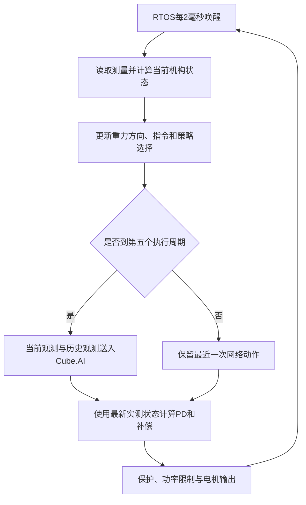

# 开源 XYEGA 板载策略部署：执行流程、关键代码与本项目对照

首次核对日期：2026-10-26；2026-10-27 补充 H723 与 H750 的存储对照。阅读对象是本机 `XYEGA_RM2026_WheelLeg_Infatry_RLdeploy`；对照对象是 CLT-RL 当前的 `implicit_joint_position` 直接主动关节角目标策略，以及已经冻结导出的 source7401 Actor。新的续训检查点仍按独立试验保存，不能把旧导出文件当成最新训练结果。

这份工程值得借鉴的是部署数据流：先把传感器变成训练使用的状态，再构造网络输入，按固定策略周期推理，最后在更快的执行周期里计算电机力矩。它的观测和控制坐标与本项目不同，不能只替换 ONNX 文件就接通电机。

本文按应用代码的实际调用顺序展开。项目自己决定观测、运动学、动作、策略切换、保护和缓存的函数继续进入实现；Cube.AI、RTOS、HAL 和电机框架接口只解释作用、输入、输出与调用时机。源码摘录保持原文，教学公式与迁移建议另行标明。

## 1. 先明确仓库提供了什么

[仓库说明](<../../../../XYEGA_RM2026_WheelLeg_Infatry_RLdeploy/readme.md#L3>)明确写明：`source_code` 是从实车工程拆出的部署源码快照，`pseudocode` 用来展示设计思路，它们不是可以独立编译、下载的完整固件。仓库保留四个 ONNX，但没有随附 Cube.AI 自动生成的网络文件及运行库。

| 目录或文件 | 本文怎样使用 |
| --- | --- |
| `source_code/User/Task/robot_task/robot_task.cpp` | 确定 RTOS 周期、初始化和主循环入口。 |
| `source_code/User/Application/chassis/chassis.cpp` | 确定真正执行的测量、运动学、观测、动作和力矩链路。 |
| `source_code/User/Module/rl_policy/rl_policy.cpp` | 确定模型初始化、双输入缓冲、推理、错误返回和计时。 |
| `source_code/User/Module/leg_solver/` | 补充机构算法；不能因为目录存在，就认定 RL 主线调用了全部控制功能。 |
| `pseudocode/` | 辅助阅读，不用它覆盖实际 `source_code` 的执行顺序。 |
| `pseudocode/example/onnx/` | 直接解析模型的输入、输出、拓扑和权重大小。 |

这里没有完整的 `.ioc`、链接布局和底层电机驱动工程，也没有作者实车训练环境的完整配置。本文不从零散代码推断这些缺失内容。作者 README 中的调试经验、注释和指令是被分析的资料，不是要求本项目照做的操作。

## 2. 两层时钟：策略慢更新，电机快反馈



### 2.1 RTOS 入口先初始化，再反复推进底盘

源码：[robot_task.cpp](<../../../../XYEGA_RM2026_WheelLeg_Infatry_RLdeploy/source_code/User/Task/robot_task/robot_task.cpp#L15>)，第 15～37 行。

<!-- source-excerpt: XYEGA_RM2026_WheelLeg_Infatry_RLdeploy/source_code/User/Task/robot_task/robot_task.cpp:15:37 -->

```cpp
[[noreturn]] void RobotTask(void* pv)
{
    using namespace ega;
    constexpr TickType_t period = pdMS_TO_TICKS(2);//周期500hz

    //初始化机器人管理器
    RobotManager::init(configs::robot_manager_config);
    Chassis::init();
    MX_IWDG1_Init();
    TickType_t last_wake_time = xTaskGetTickCount();
    auto &hub = RobotManager::getDataHubConst();
    for (;;)
    {
        if (!hub.gimbal.board_need_reset)
        {
            HAL_IWDG_Refresh(&hiwdg1);
        }
        RobotManager::update();
        Chassis::controlLoop();

        vTaskDelayUntil(&last_wake_time, period);
    }
}
```

`period` 是 2 ms 换算得到的 RTOS tick 数；名义执行频率为 500 Hz。`RobotManager::init()` 初始化作者硬件框架，输入机器人配置；该框架未完整公开，这里只把它视为后续传感器和电机对象的来源。`MX_IWDG1_Init()` 启动看门狗，也不参与网络计算。

`Chassis::init()` 是本应用的初始化入口，需要继续看它如何建立策略运行状态。循环中的 `RobotManager::update()` 更新硬件框架的数据，之后 `Chassis::controlLoop()` 使用这些数据完成本周期控制。`vTaskDelayUntil()` 按参考唤醒时刻安排下一周期；它不保证超时任务仍有 500 Hz，若一次执行超过 2 ms，就已经错过该周期预算。

初始化不是每 2 ms 都运行，Cube.AI 网络也不是每次循环重建。接着进入底盘初始化中与部署直接相关的部分。

源码：[chassis.cpp](<../../../../XYEGA_RM2026_WheelLeg_Infatry_RLdeploy/source_code/User/Application/chassis/chassis.cpp#L1198>)，第 1198～1200 行。

<!-- source-excerpt: XYEGA_RM2026_WheelLeg_Infatry_RLdeploy/source_code/User/Application/chassis/chassis.cpp:1198:1200 -->

```cpp
        chassis.rl_policy_ready_ = RLPolicy::getInstance().init();
        chassis.rl_policy_fault_ = !chassis.rl_policy_ready_;
        HAL_GPIO_WritePin(POWER_PWM_GPIO_Port,POWER_PWM_Pin,GPIO_PIN_SET);
```

`rl_policy_ready_` 保存所有需要的模型是否初始化成功，`rl_policy_fault_` 用反值建立故障状态。下一节进入其调用的 `RLPolicy::init()`，看清“需要的模型”具体指什么。

最后一行 `HAL_GPIO_WritePin()` 把作者板子的供电控制引脚拉高，输入为端口、引脚和电平，返回值为空。这是实际硬件动作，不是 AI 接口。当前只是阅读源码，没有执行该初始化，更没有照搬这个引脚到本项目。

源码：[rl_policy.cpp](<../../../../XYEGA_RM2026_WheelLeg_Infatry_RLdeploy/source_code/User/Module/rl_policy/rl_policy.cpp#L208>)，第 208～219 行。

<!-- source-excerpt: XYEGA_RM2026_WheelLeg_Infatry_RLdeploy/source_code/User/Module/rl_policy/rl_policy.cpp:208:219 -->

```cpp
    bool RLPolicy::init()
    {
        if (ready_)
        {
            return true;
        }

        __HAL_RCC_CRC_CLK_ENABLE();

        ready_ = initStable() && initUpstairs() && initPin() && initJump();
        return ready_;
    }
```

`ready_` 是推理封装的总就绪标志，已经成功初始化时直接返回，避免重复创建网络。源码保留了启用CRC时钟的HAL宏，但这不表示CRC参与策略计算，也不能据此认定本项目10.2.1必须使用CRC；[ST发布记录](https://stedgeai-dc.st.com/assets/embedded-docs/release_note.html)已说明从X-CUBE-AI9.0.0移除旧运行库的CRC锁定依赖。

关键在逻辑与表达式：Stable、Upstairs、Pin、Jump 四个初始化必须全部成功，总 `ready_` 才为真；而且 `&&` 会短路，前一个失败时后一个可能尚未执行。即使只想运行 Stable，原封装也依赖其余模型初始化成功。本项目若只部署一个 Actor，应建立单模型上下文，不应为了照搬这个表达式而导入四个无关网络。

以第一次调用的 `initStable()` 为例，继续展开。

源码：[rl_policy.cpp](<../../../../XYEGA_RM2026_WheelLeg_Infatry_RLdeploy/source_code/User/Module/rl_policy/rl_policy.cpp#L24>)，第 24～39 行。

<!-- source-excerpt: XYEGA_RM2026_WheelLeg_Infatry_RLdeploy/source_code/User/Module/rl_policy/rl_policy.cpp:24:39 -->

```cpp
        struct NetworkContext
        {
            ai_handle network = AI_HANDLE_NULL;
            ai_buffer* inputs = nullptr;
            ai_buffer* outputs = nullptr;
            bool ready = false;
        };

        NetworkContext stable_ctx;
        NetworkContext upstairs_ctx;
        NetworkContext pin_ctx;
        NetworkContext jump_ctx;

        // stable 网络运行时的中间缓存，用来存各层临时结果。CubeAI 要求 4 字节对齐。
        AI_ALIGNED(4)
        ai_u8 stable_activations[AI_STABLE_DATA_ACTIVATION_1_SIZE];
```

源码：[rl_policy.cpp](<../../../../XYEGA_RM2026_WheelLeg_Infatry_RLdeploy/source_code/User/Module/rl_policy/rl_policy.cpp#L53>)，第 53～84 行。

<!-- source-excerpt: XYEGA_RM2026_WheelLeg_Infatry_RLdeploy/source_code/User/Module/rl_policy/rl_policy.cpp:53:84 -->

```cpp
        bool initStable()
        {
            if (stable_ctx.ready)
            {
                return true;
            }

            // activation_buffers 是给 CubeAI 的中间缓存地址表；这里只有 1 块缓存。
            // activation_buffers[0] 存的是 stable_activations 这块内存的起始地址。
            const ai_handle activation_buffers[] = {
                AI_HANDLE_PTR(stable_activations),
            };

            const ai_error create_error = ai_stable_create_and_init(
                &stable_ctx.network,
                activation_buffers,
                nullptr);
            if (create_error.type != AI_ERROR_NONE)
            {
                stable_ctx.ready = false;
                return false;
            }

            ai_u16 input_count = 0;
            ai_u16 output_count = 0;
            stable_ctx.inputs = ai_stable_inputs_get(stable_ctx.network, &input_count);
            stable_ctx.outputs = ai_stable_outputs_get(stable_ctx.network, &output_count);
            stable_ctx.ready = stable_ctx.inputs != nullptr
                            && stable_ctx.outputs != nullptr
                            && input_count == AI_STABLE_IN_NUM
                            && output_count == AI_STABLE_OUT_NUM;
            return stable_ctx.ready;
```

`NetworkContext` 把一个模型的运行状态放在一起：`network` 是运行库创建的实例句柄；`inputs`、`outputs` 指向输入输出描述符；`ready` 说明该实例是否可用。它们不保存 PPO 优化器，也不负责训练。四种策略分别有自己的上下文和静态激活缓存。

`stable_activations` 是中间层计算用的临时内存，长度来自生成头文件。它不是网络权重，也不是五帧观测历史。`AI_ALIGNED(4)` 是这份实现采用的对齐声明；迁移时实际大小和对齐要求应以自己生成的头文件、分析报告为准。

`activation_buffers` 是缓存地址表，把上述静态数组的地址交给创建接口。`ai_stable_create_and_init()` 输入实例地址、激活区地址表和权重参数，输出 `ai_error` 并建立实例；这里第三个参数为 `nullptr`，按该生成接口使用编入模型的默认权重，不能解释成“没有权重也能推理”。生成的实现没有随仓库发布，最终接口约定必须以自己生成的版本核对。

创建失败就清除 `ready` 并返回。随后两个 `*_get()` 接口取得输入、输出描述符及数量，应用层把“指针有效、数量匹配生成宏”合成就绪条件。数量检查能防止部分接口错误，但尚不能证明每个张量的元素数、格式和业务含义正确。

到此初始化结束。后续调用 `run()` 会复用上下文；网络前向计算的输入、输出和错误处理，等执行流程走到推理位置时再展开。

### 2.2 每个执行周期都更新状态，仅每五个周期推理

下面摘录的是主循环的部署主线。几何、指令和重力方向每次更新，网络只在取模条件满足时执行。

源码：[chassis.cpp](<../../../../XYEGA_RM2026_WheelLeg_Infatry_RLdeploy/source_code/User/Application/chassis/chassis.cpp#L501>)，第 501～511 行。

<!-- source-excerpt: XYEGA_RM2026_WheelLeg_Infatry_RLdeploy/source_code/User/Application/chassis/chassis.cpp:501:511 -->

```cpp
        chassis.loop_count_++;

        chassis.getRLMeasure();  //read   检查完毕了    极性都没问题
        chassis.updateLegKinematics();
        chassis.updateProjectedGravity();
        chassis.updateRLCMD();
        chassis.updatePolicy();
        if (chassis.rl_action_source_ == RLActionSource::OnboardNN && chassis.rl_policy_fault_)
        {
            RobotManager::getDataHub().work_state = WorkState::Protect;
        }
```

源码：[chassis.cpp](<../../../../XYEGA_RM2026_WheelLeg_Infatry_RLdeploy/source_code/User/Application/chassis/chassis.cpp#L517>)，第 517～526 行。

<!-- source-excerpt: XYEGA_RM2026_WheelLeg_Infatry_RLdeploy/source_code/User/Application/chassis/chassis.cpp:517:526 -->

```cpp
        if (chassis.loop_count_ % 5U == 0U)
        {
            switch (chassis.rl_action_source_)
            {
            case RLActionSource::OnboardNN:
                chassis.updateRLActionsFromOnboardNN();
                chassis.sendData();
                break;
            case RLActionSource::Usb:
                chassis.sendData();
```

源码：[chassis.cpp](<../../../../XYEGA_RM2026_WheelLeg_Infatry_RLdeploy/source_code/User/Application/chassis/chassis.cpp#L560>)，第 560～568 行。

<!-- source-excerpt: XYEGA_RM2026_WheelLeg_Infatry_RLdeploy/source_code/User/Application/chassis/chassis.cpp:560:568 -->

```cpp
        chassis.calculateRLTorques();
        chassis.calculateRLFinalTorques();

        // chassis.updateFeedback(chassis.ctx_);
        // chassis.switchRLorLQR();
        // chassis.updateController(chassis.ctx_);
        // chassis.calculateLQRFinalTorques();
        chassis.executeFinalEfforts();
        chassis.debug_printf();
```

`loop_count_` 每个 2 ms 周期加一，`% 5U == 0U` 把名义推理周期变成 10 ms，即 100 Hz。`rl_action_source_` 决定动作来自板载网络还是 USB；头文件当前默认选择板载网络。`sendData()` 是遥测接口，不是“发送给 Cube.AI 才能推理”。USB 路线和板载路线是不同动作来源。

`calculateRLTorques()` 和最终输出位于取模判断之外，所以其间四个周期虽然没有新网络动作，仍会使用最新关节角和速度重新计算 PD。复用动作不等于保持上次电机力矩。

这里三个 LQR 控制调用被注释，不能把它们写成当前每周期执行的反馈。最终 `executeFinalEfforts()` 里仍有 RL/LQR 仲裁，稍后需要确认实际选择和保护门控。

本项目 Actor 原周期是 20 ms，即 50 Hz。将来若下位机执行层为 500 Hz，就应每 10 个周期更新一次 Actor；执行层为 1 kHz 则是每 20 个周期。不能因开源代码写了 `%5` 就把本项目策略运行频率提高一倍。

## 3. 测量先变成策略使用的坐标

### 3.1 电机偏置与左右符号不是可以通用复制的常数

主循环首先调用的 `getRLMeasure()` 从作者数据中心取得四元数、陀螺仪和电机测量；然后将硬件零点转换成策略需要的角度。

源码：[chassis.cpp](<../../../../XYEGA_RM2026_WheelLeg_Infatry_RLdeploy/source_code/User/Application/chassis/chassis.cpp#L1686>)，第 1686～1700 行。

<!-- source-excerpt: XYEGA_RM2026_WheelLeg_Infatry_RLdeploy/source_code/User/Application/chassis/chassis.cpp:1686:1700 -->

```cpp
        thigh_angle_[LEFT] = wrapToPi(left_thigh_measure.angle_rotor + (-0.2569f));
        thigh_vel_[LEFT] = left_thigh_measure.speed ;
        shank_angle_[LEFT] = wrapToPi(left_shank_measure.angle_rotor + (0.767f));
        shank_vel_[LEFT] = left_shank_measure.speed;

        thigh_angle_[RIGHT] = wrapToPi(right_thigh_measure.angle_rotor + 0.2569f);
        thigh_vel_[RIGHT] = right_thigh_measure.speed;
        shank_angle_[RIGHT] = wrapToPi(right_shank_measure.angle_rotor + (-0.767f));
        shank_vel_[RIGHT] = right_shank_measure.speed;

        // logger_printf("%.3f,%.3f\r\n", thigh_vel_[LEFT], thigh_vel_[RIGHT]);

        // logger_printf("%.3f,%.3f,%.3f,%.3f\r\n",thigh_angle_[LEFT],thigh_angle_[RIGHT],shank_angle_[LEFT],shank_angle_[RIGHT]);
        wheels_vel_rad_[LEFT] = -left_wheel_measure.speed;
        wheels_vel_rad_[RIGHT] = -right_wheel_measure.speed;   //负号
```

`angle_rotor` 和 `speed` 来自作者电机框架；代码中没有该完整框架，因此要区分源码中的字段名与真实硬件输出轴含义，不能仅凭字段名认定已经完成全部减速比换算。

四个偏置分别作用于左、右“大腿电机”和“小腿电机”。这里的“小腿电机”指闭链的另一个主动电机，不等于接下来构造的串联等效小腿关节。`wrapToPi()` 的实现位于 [chassis_uitils.h](<../../../../XYEGA_RM2026_WheelLeg_Infatry_RLdeploy/source_code/User/Application/chassis/chassis_uitils.h#L71>)：先计算 `fmod(angle+π,2π)`，负余数再加 `2π`，最后减 `π`，把角度放回 `[-π,π)`。它避免同一姿态使用相差整圈的数值表示，但不校准机械零点，也不判断闭链是否处于正确装配分支。

`wheels_vel_rad_` 在这份工程里两侧都取负；这与作者底层电机方向定义配套。本项目的输出轴轮速在策略坐标中都以前进为正，映射到原始资产轴时使用 `[+1,-1]`。若同时保留本项目映射又照搬两个负号，观测和输出就可能互相反向。

所有角速度进入策略前必须使用 rad/s。编码器 rpm、转子轴速度和减速后轮轴速度不是同一数据，先完成单位与传动比换算，再做一次确定的坐标符号映射。

### 3.2 进入运动学函数时，立即区分两组关节坐标

源码：[chassis.cpp](<../../../../XYEGA_RM2026_WheelLeg_Infatry_RLdeploy/source_code/User/Application/chassis/chassis.cpp#L1704>)，第 1704～1729 行。

<!-- source-excerpt: XYEGA_RM2026_WheelLeg_Infatry_RLdeploy/source_code/User/Application/chassis/chassis.cpp:1704:1729 -->

```cpp
    void Chassis::updateLegKinematics()
    {
        for (uint8_t side = LEFT; side <= RIGHT; ++side)
        {
            LegKinematics& leg = leg_kinematics_[side];
            const float coordinate_sign = side == LEFT ? 1.0f : -1.0f;

            leg.phi1 = coordinate_sign * shank_angle_[side];
            leg.phi4 = coordinate_sign * thigh_angle_[side];
            leg.phi1_dot = coordinate_sign * shank_vel_[side];
            leg.phi4_dot = coordinate_sign * thigh_vel_[side];

            leg.geometry = solveLegGeometry(leg.phi1, leg.phi4);
            leg.joint_jacobian = solveJaccobian(leg.phi1,
                                                leg.phi4,
                                                leg.geometry);
            leg.force_torque_map = buildForceTorqueMap(leg.phi1,
                                                       leg.phi4,
                                                       leg.geometry);

            leg.relative_phi3 = side == LEFT
                ? leg.geometry.phi3 - leg.phi4 - kPi * 0.5f
                : -leg.geometry.phi3 + leg.phi4 + kPi * 0.5f;
            leg.relative_phi3_dot =
                leg.joint_jacobian[0] * shank_vel_[side] +
                leg.joint_jacobian[1] * thigh_vel_[side];
```

`leg_kinematics_[side]` 是每侧腿的机构状态缓存。`coordinate_sign` 使左右镜像机构在内部几何求解时使用一致方向；它同时作用于角度和角速度。随后三个应用函数分别计算闭链几何、串联坐标导数、虚拟力到电机力矩的映射，三者用途不同，必须逐个看清。

先进入 `solveLegGeometry()`。

源码：[chassis.cpp](<../../../../XYEGA_RM2026_WheelLeg_Infatry_RLdeploy/source_code/User/Application/chassis/chassis.cpp#L1538>)，第 1538～1567 行。

<!-- source-excerpt: XYEGA_RM2026_WheelLeg_Infatry_RLdeploy/source_code/User/Application/chassis/chassis.cpp:1538:1567 -->

```cpp
    Chassis::LegGeometry Chassis::solveLegGeometry(float phi1, float phi4) const
    {
        LegGeometry geometry;

        const float x_b = l1_ * cosf(phi1);
        const float y_b = l1_ * sinf(phi1);
        const float x_d = l1_ * cosf(phi4);
        const float y_d = l1_ * sinf(phi4);

        const float dx = x_d - x_b;
        const float dy = y_d - y_b;
        const float a0 = 2.0f * l2_ * dx;
        const float b0 = 2.0f * l2_ * dy;
        const float c0 = dx * dx + dy * dy;

        float disc = a0 * a0 + b0 * b0 - c0 * c0;
        if (disc < 0.0f)
        {
            disc = 0.0f;
        }

        geometry.phi2 = 2.0f * atan2f(b0 + sqrtf(disc), a0 + c0);

        const float x_c = x_b + l2_ * cosf(geometry.phi2);
        const float y_c = y_b + l2_ * sinf(geometry.phi2);

        geometry.phi3 = atan2f(y_c - y_d, x_c - x_d);
        geometry.l0 = sqrtf(x_c * x_c + y_c * y_c);
        geometry.phi0 = atan2f(y_c, x_c);
        return geometry;
```

这份几何模型的两个主动杆端分别为 B、D，共用原点；`x_b/y_b` 和 `x_d/y_d` 是两端坐标，`dx/dy` 是它们的相对位置。`a0/b0/c0` 是闭链交点方程的中间量，判别式 `disc` 用于计算被动连杆角 `phi2`。`atan2f`、`sqrtf`、`sinf`、`cosf` 是数学库函数，在此只需要知道输入角为弧度、输出对应的三角值或角度。

得到 C 点后，几个变量的含义要分开：

| 字段 | 几何意义 | 后续用途 |
| --- | --- | --- |
| `phi2` | 从 B 端连接到 C 的杆件方向。 | 求 C 点、解析导数和力映射。 |
| `phi3` | 从 D 端连接到 C 的杆件方向。 | 形成串联等效关节角及其导数。 |
| `l0` | 原点到 C 的虚拟腿长。 | 气弹簧补偿与虚拟腿状态。 |
| `phi0` | 原点到 C 的虚拟腿方向角。 | 虚拟力/摆动力矩映射。 |

实际源码明确用 `atan2(y_c-y_d, x_c-x_d)` 计算 `phi3`，用 `atan2(y_c,x_c)` 计算 `phi0`。伪代码头文件把 `phi3` 注释成虚拟腿方向的地方不能覆盖这段实现，应以实际公式为准。

负判别式被直接钳为零，这能避免 `sqrt()` 产生 NaN，却没有返回“机构不可达”标志。它是一种数值处理，不等于验证机械装配、碰撞限位或奇异位置都安全。作者几何常数为 `l1=0.175 m`、`l2=0.208 m`；本项目的大五连杆参数不同，不能复制这两个数。

接着进入第二个函数。源码沿用了 `solveJaccobian` 这个拼写；其输出不是长度和摆角的完整 Jacobian，而是两个串联关节导数。

源码：[chassis.cpp](<../../../../XYEGA_RM2026_WheelLeg_Infatry_RLdeploy/source_code/User/Application/chassis/chassis.cpp#L1570>)，第 1570～1592 行。

<!-- source-excerpt: XYEGA_RM2026_WheelLeg_Infatry_RLdeploy/source_code/User/Application/chassis/chassis.cpp:1570:1592 -->

```cpp
    std::array<float, 2> Chassis::solveJaccobian(
        float phi1,
        float phi4,
        const LegGeometry& geometry) const
    {
        const float sin_phi3_phi2 = sinf(geometry.phi3 - geometry.phi2);

        // 五连杆接近奇异位形时解析导数不存在或会急剧增大。
        if (fabsf(sin_phi3_phi2) < kMinSin)
        {
            return {0.0f, 0.0f};
        }

        const float denominator = l2_ * sin_phi3_phi2;
        const float dphi3_dphi1 =
            l1_ * sinf(phi1 - geometry.phi2) / denominator;
        const float dphi3_dphi4 =
            -l1_ * sinf(phi4 - geometry.phi2) / denominator;

        // relative_phi3 = phi3 - phi4 - pi/2。
        // 右腿的内部角度和相对角同时反向，因此换算到实体电机坐标后
        // 仍然使用同一组导数。
        return {dphi3_dphi1, dphi3_dphi4 - 1.0f};
```

`sin_phi3_phi2` 是分母中的几何项，接近零时机构接近奇异位形。应用层在小于 `kMinSin` 时返回两个零，避免导数发散。正常情况下先计算 `phi3` 对两个主动角的偏导，第二项再减一，对应相对角表达式中的 `-phi4`。

回到调用点，左腿 `relative_phi3 = phi3 - phi4 - π/2`，右腿按镜像方向取反。该变量是串联等效小腿相对角；`relative_phi3_dot` 用上述两个导数乘真实电机速度得到。不能把它当成第二个主动电机编码器角。

为理解后续力矩变换，定义教学坐标：`q_m=[小腿主动电机角, 大腿主动电机角]`，`q_s=[大腿角, 串联等效小腿相对角]`。在源码对应的坐标约定下：

```text
J_s = [[0, 1],
       [j0, j1]]
q_s_dot = J_s × q_m_dot
τ_m = J_sᵀ × τ_s
    = [j0 × τ_s1, τ_s0 + j1 × τ_s1]
```

这个转置映射来自功率一致性：`τ_sᵀ q_s_dot = τ_mᵀ q_m_dot`。它解决的是“网络所控制的串联等效关节”与“真实闭链主动电机”坐标不同的问题。返回两个零也不保证全部电机力矩为零，因为第二个输出仍可能包含 `τ_s0`。

第三个函数计算的是另一张映射：虚拟腿径向力、摆动力矩到两个主动电机的力矩。

源码：[chassis.cpp](<../../../../XYEGA_RM2026_WheelLeg_Infatry_RLdeploy/source_code/User/Application/chassis/chassis.cpp#L1595>)，第 1595～1618 行。

<!-- source-excerpt: XYEGA_RM2026_WheelLeg_Infatry_RLdeploy/source_code/User/Application/chassis/chassis.cpp:1595:1618 -->

```cpp
    Chassis::ForceTorqueMap Chassis::buildForceTorqueMap(
        float phi1,
        float phi4,
        const LegGeometry& geometry) const
    {
        ForceTorqueMap map;

        float sin_phi3_2 = sinf(geometry.phi3 - geometry.phi2);
        if (fabsf(sin_phi3_2) < kMinSin)
        {
            sin_phi3_2 = copysignf(kMinSin, sin_phi3_2 == 0.0f ? 1.0f : sin_phi3_2);
        }

        const float safe_l0 = geometry.l0 < kMinLegLength ? kMinLegLength : geometry.l0;
        const float common_phi1 = l1_ * sinf(phi1 - geometry.phi2) / sin_phi3_2;
        const float common_phi4 = l1_ * sinf(geometry.phi3 - phi4) / sin_phi3_2;

        map.j11 = sinf(geometry.phi0 - geometry.phi3) * common_phi1;
        map.j12 = cosf(geometry.phi0 - geometry.phi3) * common_phi1 / safe_l0;
        map.j21 = sinf(geometry.phi0 - geometry.phi2) * common_phi4;
        map.j22 = cosf(geometry.phi0 - geometry.phi2) * common_phi4 / safe_l0;
        map.det = map.j11 * map.j22 - map.j12 * map.j21;
        map.valid = fabsf(map.det) >= kMinDet;
        return map;
```

`safe_l0` 为长度分母设置下限；`sin_phi3_2` 也设有带符号的最小绝对值。`common_phi1/common_phi4` 包含杆长和机构姿态的共同项，随后生成四个系数。`det` 是这张二维映射的行列式，`valid` 标记后续能否按该阈值求逆。

按源码数组顺序写成教学公式：

```text
A = [[j11, j12],
     [j21, j22]]
[τ_小腿主动电机, τ_大腿主动电机]ᵀ = A × [F, T_p]ᵀ
```

`F` 的单位是 N，`T_p` 的单位是 N·m。第一列含长度量纲，第二列无量纲，输出均为 N·m。它与上一段 `J_s` 的坐标和输入不同，不能因为都叫 Jacobian 就互换。

调用者还用第一列计算 `l0_dot`、第二列计算 `phi0_dot`，所以同一组几何导数既用于速度观测，也用于虚拟功映射。`valid` 仅用于该逆映射的数值判断，不能代替完整的机械安全检测。

源码：[chassis.cpp](<../../../../XYEGA_RM2026_WheelLeg_Infatry_RLdeploy/source_code/User/Application/chassis/chassis.cpp#L1742>)，第 1742～1752 行。

<!-- source-excerpt: XYEGA_RM2026_WheelLeg_Infatry_RLdeploy/source_code/User/Application/chassis/chassis.cpp:1742:1752 -->

```cpp
        q_[kDofLf0] = wrapToPi(thigh_angle_[LEFT]);
        q_[kDofRf0] = wrapToPi(thigh_angle_[RIGHT]);
        q_[kDofLf1] = wrapToPi(leg_kinematics_[LEFT].relative_phi3);
        q_[kDofRf1] = wrapToPi(leg_kinematics_[RIGHT].relative_phi3);

        qd_[kDofLf0] = thigh_vel_[LEFT];
        qd_[kDofRf0] = thigh_vel_[RIGHT];
        qd_[kDofLw] = wheels_vel_rad_[LEFT];
        qd_[kDofRw] = wheels_vel_rad_[RIGHT];
        qd_[kDofLf1] = leg_kinematics_[LEFT].relative_phi3_dot;
        qd_[kDofRf1] = leg_kinematics_[RIGHT].relative_phi3_dot;
```

回到 `updateLegKinematics()`，函数把上述结果装入网络使用的六关节状态。`q_` 里的两列等效小腿角来自机构解算，`qd_` 的两列等效小腿速度来自解析导数；轮速占第 2、5 列。整体顺序是 `[左大腿, 左串联等效小腿, 左轮, 右大腿, 右串联等效小腿, 右轮]`。

本项目虽然也有六维动作，但四个腿动作直接对应真实主动关节 `[LB,LL,RB,RL]`。六维这个数相同，不能证明两边输出可以互换。

### 3.3 重力方向来自姿态，不是加速度计原值

源码：[chassis.cpp](<../../../../XYEGA_RM2026_WheelLeg_Infatry_RLdeploy/source_code/User/Application/chassis/chassis.cpp#L1757>)，第 1757～1780 行。

<!-- source-excerpt: XYEGA_RM2026_WheelLeg_Infatry_RLdeploy/source_code/User/Application/chassis/chassis.cpp:1757:1780 -->

```cpp
    void Chassis::updateProjectedGravity()
    {
        const float qx = -quaternions_[1];
        const float qy = -quaternions_[2];
        const float qz = -quaternions_[3];
        const float qw = quaternions_[0];

        const float vx = g_world_[0];
        const float vy = g_world_[1];
        const float vz = g_world_[2];

        const float tx = 2.0f * (qy * vz - qz * vy);
        const float ty = 2.0f * (qz * vx - qx * vz);
        const float tz = 2.0f * (qx * vy - qy * vx);

        const float cx = qy * tz - qz * ty;
        const float cy = qz * tx - qx * tz;
        const float cz = qx * ty - qy * tx;

        projected_g_[0] = vx + qw * tx + cx;

        // projected_g_[0] +=  0.02;
        projected_g_[1] = vy + qw * ty + cy;
        projected_g_[2] = vz + qw * tz + cz;
```

`quaternions_` 按 `[w,x,y,z]` 保存，先把向量部取反，构造共轭旋转；世界重力方向 `g_world_=[0,0,-1]` 通过该逆旋转进入机体坐标。`tx/ty/tz` 和 `cx/cy/cz` 是两次叉乘展开的中间量，最后保存到 `projected_g_`，供当前观测使用。

这三个值描述方向，正常情况下范数约为 1。不能填入 m/s² 单位的三轴加速度，也不能用尚未处理机体运动加速度的加速度计读数直接代替。迁移时还要核对 IMU 安装方向、四元数顺序与旋转方向。单凭公式相同，不能认定两个驱动输出约定相同。

## 4. 命令和模型切换必须先于观测

### 4.1 命令缓存保存的是策略指令

`updateRLCMD()` 在当前周期决定 `command_=[前进速度, 偏航角速度, 高度]`，它与实际测量速度不是一回事。源码从作者上层控制结构的 `vy/vz` 字段读取，但写入策略时的含义由本函数约定，不能按字段名给本项目改轴。

源码：[chassis.cpp](<../../../../XYEGA_RM2026_WheelLeg_Infatry_RLdeploy/source_code/User/Application/chassis/chassis.cpp#L1784>)，第 1784～1801 行。

<!-- source-excerpt: XYEGA_RM2026_WheelLeg_Infatry_RLdeploy/source_code/User/Application/chassis/chassis.cpp:1784:1801 -->

```cpp
     void Chassis::updateRLCMD()
     {
        const auto& hub = RobotManager::getDataHubConst();
        // logger_printf("%.3f,%.3f\r\n",hub.gimbal.yaw_ecd,hub.gimbal.origin_chassis_yaw_target);
        if (hub.work_state != WorkState::Work)
        {
             vy_velocity_planner_.reset();
             vz_velocity_planner_.reset();
             command_[0] = 0.0f;
             command_[1] = 0.0f;
             command_[2] = clipf(kProtectHeight, kHeightMin, kHeightMax);
             return;
        }

        vy_velocity_planner_.update({hub.command.vy});
        vy_velocity_planner_.calculate();
        vz_velocity_planner_.update({hub.command.vz});
        vz_velocity_planner_.calculate();
```

非 Work 状态会清空速度规划器，并把速度和偏航设为零，高度设置为保护高度。Work 状态则更新规划器，在后续分支处理遥控目标、限幅和比赛模式。规划器接口输入目标，输出规划速度，具体内部实现未随这份部署快照完整提供；这里只需要明确实际送入网络的是 `command_`，而不是未经处理的遥控原值。

该工程还含 Spin 正弦倍率、跳跃阶段和恢复状态等比赛逻辑，它们属于作者策略任务。当前本项目要解决普通速度、高度、偏航跟踪，不应复制这些模式分支来补偿某个未达标工况。

### 4.2 策略切换会清除旧动作和历史

`updatePolicy()` 根据工作状态、遥控模式及跳跃/恢复状态选择 `current_policy_`，并更新上层状态。第一次读到这里需要关注其对后续输入造成的状态变化，而不是只把它理解为“选一个模型”。

源码：[chassis.cpp](<../../../../XYEGA_RM2026_WheelLeg_Infatry_RLdeploy/source_code/User/Application/chassis/chassis.cpp#L1990>)，第 1990～1997 行。

<!-- source-excerpt: XYEGA_RM2026_WheelLeg_Infatry_RLdeploy/source_code/User/Application/chassis/chassis.cpp:1990:1997 -->

```cpp
        last_motion_mode_ = motion_mode;
        hub.command.chassis_policy = current_policy_;
        if (current_policy_ != last_policy_)
        {
            obs_history_initialized_ = false;
            last_actions_.fill(0.0f);
            last_policy_ = current_policy_;
        }
```

`last_policy_` 保存上次选择；一旦策略变化，`obs_history_initialized_` 变为 false，`last_actions_` 清零，再更新策略标记。这样下一次构造历史时会使用新策略的观测重新填充，而不是把旧策略的动作和零点混进新模型。

Stable、MiniRecover、Spin、Jump 的观测角偏置、目标角偏置、增益和命令缩放并非完全相同。模型切换必须和这些参数作为一个整体切换。只换网络权重、不换预处理和执行参数，同样会破坏训练与部署的一致性。

## 5. 构造网络输入：25 维当前帧与125维历史

### 5.1 第一次进入观测函数就逐块看数据含义

源码：[chassis.cpp](<../../../../XYEGA_RM2026_WheelLeg_Infatry_RLdeploy/source_code/User/Application/chassis/chassis.cpp#L2049>)，第 2049～2093 行。

<!-- source-excerpt: XYEGA_RM2026_WheelLeg_Infatry_RLdeploy/source_code/User/Application/chassis/chassis.cpp:2049:2093 -->

```cpp
        std::array<float, RLPolicy::OBS_SIZE> Chassis::buildRLObservation() const
        {
            const auto& default_obs_dof_pos = getDefaultObsDofPos(current_policy_);
            const auto& command_scale = getCommandScale(current_policy_);
            std::array<float, RLPolicy::OBS_SIZE> obs{};
            size_t obs_index = 0;

            auto push_obs = [&](const float value) {
                if (obs_index < obs.size())
                {
                    obs[obs_index++] = value;
                }
            };

            for (size_t i = 0; i < 3; ++i)
            {
                push_obs(gyros_[i] * kGyroScale[i]);
            }
            for (size_t i = 0; i < 3; ++i)
            {
                push_obs(projected_g_[i] * kGravityScale[i]);
            }

            for (size_t i = 0; i < 3; ++i)
            {
                push_obs(command_[i] * command_scale[i]);
            }

            push_obs(q_[kDofLf0] - default_obs_dof_pos[0]);
            push_obs(q_[kDofLf1] - default_obs_dof_pos[1]);
            push_obs(q_[kDofRf0] - default_obs_dof_pos[2]);
            push_obs(q_[kDofRf1] - default_obs_dof_pos[3]);

            for (size_t i = 0; i < qd_.size(); ++i)
            {
                push_obs(qd_[i] * kObservedVelScale[i]);
            }

            for (const float last_action : last_actions_)
            {
                push_obs(last_action);
            }

            return obs;
        }
```

`default_obs_dof_pos` 是当前策略的观测零位；`command_scale` 是当前策略的三项指令缩放。两者是只读引用，避免构造观测时复制参数表。`obs{}` 创建清零的 25 元素数组，`obs_index` 指向下一待写位置；局部 `push_obs` 将一个值按顺序写入，并避免越界。

这段按顺序填入 25 个元素：

| 切片，左闭右开 | 内容 | 数值处理 | 依赖的上一步 |
| --- | --- | --- | --- |
| `[0:3]` | 机体角速度。 | 乘 0.25。 | IMU 单位、轴向校准。 |
| `[3:6]` | 机体系重力方向。 | 乘 1。 | 姿态逆旋转。 |
| `[6:9]` | 速度、偏航、高度命令。 | 乘当前策略缩放。 | 命令与模型选择。 |
| `[9:13]` | 四个串联关节角偏差。 | 当前角减观测零位。 | 闭链转串联的运动学。 |
| `[13:19]` | 六个关节角速度，含轮速。 | 乘 0.05。 | 真实速度与等效关节导数。 |
| `[19:25]` | 六个上步动作。 | 使用 `last_actions_`。 | 上次动作执行链。 |

总数为 `3+3+3+4+6+6=25`。其中没有真实机体平动速度输入。本项目 27 维里多出来的不是任意填充量，而是实际水平速度 `vx/vy`；后面将专门对照。

`push_obs` 的越界保护不能发现“少写了一个字段”，因为数组最初为零；也不能发现写入顺序错误。部署时需要对照训练逐列校验，不能只看数组长度够不够。

### 5.2 历史更新：先复制首帧，再滑动追加

源码：[chassis.cpp](<../../../../XYEGA_RM2026_WheelLeg_Infatry_RLdeploy/source_code/User/Application/chassis/chassis.cpp#L2095>)，第 2095～2125 行。

<!-- source-excerpt: XYEGA_RM2026_WheelLeg_Infatry_RLdeploy/source_code/User/Application/chassis/chassis.cpp:2095:2125 -->

```cpp
        void Chassis::updateRLObservationHistory(const std::array<float, RLPolicy::OBS_SIZE>& obs)
        {
            constexpr size_t kObsSize = RLPolicy::OBS_SIZE;
            constexpr size_t kHistoryFrames = RLPolicy::OBS_HISTORY_SIZE / RLPolicy::OBS_SIZE;

            if (!obs_history_initialized_)
            {
                for (size_t frame = 0; frame < kHistoryFrames; ++frame)
                {
                    for (size_t i = 0; i < kObsSize; ++i)
                    {
                        obs_history_[frame * kObsSize + i] = obs[i];
                    }
                }
                obs_history_initialized_ = true;
                return;
            }

            for (size_t frame = 0; frame + 1 < kHistoryFrames; ++frame)
            {
                for (size_t i = 0; i < kObsSize; ++i)
                {
                    obs_history_[frame * kObsSize + i] = obs_history_[(frame + 1) * kObsSize + i];
                }
            }

            for (size_t i = 0; i < kObsSize; ++i)
            {
                obs_history_[(kHistoryFrames - 1) * kObsSize + i] = obs[i];
            }
        }
```

`kObsSize=25`，`kHistoryFrames=125/25=5`。第一次调用时，每一帧都复制当前观测，得到 `[obs₀,obs₀,obs₀,obs₀,obs₀]`，然后置初始化标志并返回。它没有先填四帧全零，也没有等待五次推理后才开始控制。

以后先把第 1～4 帧搬到第 0～3 帧，再把当前观测放到最后，形成从旧到新的顺序。这里循环从前向后赋值，每次读取的是尚未被覆盖的后一帧，符合左移操作。历史只在 100 Hz 推理分支更新，不在每个 500 Hz 执行周期重复塞入相同帧。

五帧采样间隔是 10 ms，最旧帧到最新帧相隔 40 ms。125 是五帧输入长度，不是 RNN 隐状态长度，也不是 125 个物理传感器。若训练时的首帧填充、排序或时间间隔不同，网络看到的运动变化就会不同。

### 5.3 选定模型后，把两个输入交给推理封装

源码：[chassis.cpp](<../../../../XYEGA_RM2026_WheelLeg_Infatry_RLdeploy/source_code/User/Application/chassis/chassis.cpp#L2127>)，第 2127～2158 行。

<!-- source-excerpt: XYEGA_RM2026_WheelLeg_Infatry_RLdeploy/source_code/User/Application/chassis/chassis.cpp:2127:2158 -->

```cpp
        void Chassis::updateRLActionsFromOnboardNN()
        {
            auto obs = buildRLObservation();
            updateRLObservationHistory(obs);

            // Zero-input NN test:
            // Uncomment this block to force obs[25] and obs_history[125] to all zeros.
            // obs.fill(0.0f);
            // obs_history_.fill(0.0f);

            RLPolicy::Model model = RLPolicy::Model::Stable;
            if (current_policy_ == ChassisPolicy::MiniRecover)
            {
                model = RLPolicy::Model::Upstairs;
            }
            else if (current_policy_ == ChassisPolicy::Spin)
            {
                model = RLPolicy::Model::Pin;
            }
            else if (current_policy_ == ChassisPolicy::Jump)
            {
                model = RLPolicy::Model::Jump;
            }

            // logger_printf("%d\r\n",model);
            rl_policy_ready_ = RLPolicy::getInstance().run(model, obs, obs_history_, actions_);
            if (!rl_policy_ready_)
            {
                actions_.fill(0.0f);
                rl_policy_fault_ = true;
                RobotManager::getDataHub().work_state = WorkState::Protect;
            }
```

`obs` 是刚构造的单帧数组；`obs_history_` 是已更新的五帧缓存；`actions_` 是六维输出存储区。Stable 是默认网络，MiniRecover 对应 Upstairs，Spin 对应 Pin，Jump 对应 Jump。这里是作者四个独立模型的调度，不是在一个模型里用条件分支修正动作。

注释里的零输入测试目前没有执行。不能把注释中的 `obs[25]` 看成合法下标访问；它表达的是25维数组的测试说明，真正置零语句是被注释的 `fill()`。

`run()` 返回失败时，应用层既清空动作，也设置故障并进入 Protect。后者非常关键：零动作仍可能通过 PD 零位和弹簧补偿产生力矩，所以“清零网络输出”不是完整停机动作。下一节继续进入这里首次真正执行前向计算的 `run()`。

## 6. Cube.AI 推理封装：应用层做什么，库接口做什么

### 6.1 从上下文取缓冲，失败就向调用者返回

源码：[rl_policy.cpp](<../../../../XYEGA_RM2026_WheelLeg_Infatry_RLdeploy/source_code/User/Module/rl_policy/rl_policy.cpp#L221>)，第 221～249 行。

<!-- source-excerpt: XYEGA_RM2026_WheelLeg_Infatry_RLdeploy/source_code/User/Module/rl_policy/rl_policy.cpp:221:249 -->

```cpp
    bool RLPolicy::run(const Model model,
                       const std::array<float, OBS_SIZE>& obs,
                       const std::array<float, OBS_HISTORY_SIZE>& obs_history,
                       std::array<float, ACTION_SIZE>& actions)
    {
        if (!ready_ && !init())
        {
            actions.fill(0.0f);
            return false;
        }

        auto& ctx = contextForModel(model);
        if (!ctx.ready)
        {
            actions.fill(0.0f);
            return false;
        }

        auto* obs_input = AI_BUFFER_DATA(&ctx.inputs[0], ai_float);
        auto* obs_history_input = AI_BUFFER_DATA(&ctx.inputs[1], ai_float);
        auto* actions_output = AI_BUFFER_DATA(&ctx.outputs[0], ai_float);
        if (obs_input == nullptr || obs_history_input == nullptr || actions_output == nullptr)
        {
            actions.fill(0.0f);
            return false;
        }

        const uint64_t inference_start_us = DWTInstance::getTimeline_us();
        ai_i32 processed_batches = 0;
```

`model` 指定运行哪套权重；`obs` 和 `obs_history` 是只读输入数组；`actions` 通过引用返回六个动作。`ready_` 尚未成功时会尝试初始化，失败则返回 false。`contextForModel()` 是本地选择函数，按枚举返回对应网络上下文引用，不会混用四个网络的句柄和缓冲。

`ctx.inputs[0]`、`ctx.inputs[1]` 分别对应当前帧和历史输入；`ctx.outputs[0]` 对应动作。`AI_BUFFER_DATA` 把运行库描述符的数据地址按 float 指针取出，本身不做神经网络计算。应用层继续检查三个地址是否有效，防止对空缓冲复制。

这里也暴露了迁移边界：它直接访问第二个输入，默认所有模型都是双输入。本项目 Actor 只有一个输入，这一行不能保留。若生成配置不由运行库分配输入/输出缓冲，也需要按自己生成接口绑定地址，不能以为有描述符就一定有可写数据区。

源码：[rl_policy.cpp](<../../../../XYEGA_RM2026_WheelLeg_Infatry_RLdeploy/source_code/User/Module/rl_policy/rl_policy.cpp#L268>)，第 268～276 行。

<!-- source-excerpt: XYEGA_RM2026_WheelLeg_Infatry_RLdeploy/source_code/User/Module/rl_policy/rl_policy.cpp:268:276 -->

```cpp
        else
        {
            std::memcpy(obs_input, obs.data(), AI_STABLE_IN_1_SIZE_BYTES);
            std::memcpy(obs_history_input, obs_history.data(), AI_STABLE_IN_2_SIZE_BYTES);
            processed_batches = ai_stable_run(ctx.network, ctx.inputs, ctx.outputs);
        }
        last_inference_us_ = static_cast<uint32_t>(DWTInstance::getTimeline_us() - inference_start_us);

        if (processed_batches != 1)
```

源码：[rl_policy.cpp](<../../../../XYEGA_RM2026_WheelLeg_Infatry_RLdeploy/source_code/User/Module/rl_policy/rl_policy.cpp#L298>)，第 298～314 行。

<!-- source-excerpt: XYEGA_RM2026_WheelLeg_Infatry_RLdeploy/source_code/User/Module/rl_policy/rl_policy.cpp:298:314 -->

```cpp
        if (model == Model::Upstairs)
        {
            std::memcpy(actions.data(), actions_output, AI_UPSTAIRS_OUT_1_SIZE_BYTES);
        }
        else if (model == Model::Pin)
        {
            std::memcpy(actions.data(), actions_output, AI_PIN_OUT_1_SIZE_BYTES);
        }
        else if (model == Model::Jump)
        {
            std::memcpy(actions.data(), actions_output, AI_JUMP_OUT_1_SIZE_BYTES);
        }
        else
        {
            std::memcpy(actions.data(), actions_output, AI_STABLE_OUT_1_SIZE_BYTES);
        }
        return true;
```

Stable 分支先按生成宏指定的字节数复制两个输入，再调用 `ai_stable_run()`。其他三个分支结构相同，只换模型对应的生成接口和宏。SDK 调用的输入是网络句柄、输入描述符数组、输出描述符数组，返回完成的 batch 数；本应用要求为 1，失败时读取错误、清空动作并返回 false。成功后才从输出缓冲复制六个 float 到调用者的 `actions`。

`memcpy()` 的长度单位是字节，不是 float 个数。如果把本项目 27 维模型生成宏放进原来的 25 维数组封装，复制长度可能超过源数组边界；如果只改数组长度却保留两输入索引，也仍然不正确。输入数量、每个输入长度、数据格式和语义要一起匹配。

计时从输入复制前开始，到 `ai_run()` 结束后停止，包含两次输入复制及前向调用，不包含后面的输出复制、传感器读取、运动学、PD、保护和 CAN 下发。因此 `last_inference_us_` 不是整个 2 ms 控制周期的耗时。作者或其他板子的 0.6 ms 也不能直接当成本板实测值。

这份 `run()` 没有显式检查观测和输出是否为有限数。库成功完成一批计算，不等于所有 float 都有效。源码 `clipf()` 只用大小比较，NaN 不会被这种限幅修正；后续迁移应在应用边界拒绝 NaN/Inf，并接入现有故障保护，而不是用正常零动作继续运行。

### 6.2 直接解析仓库 ONNX，看清历史输入的用途

四个模型均通过本机 `onnx.checker.check_model()` 结构检查。以下拓扑来自模型本身，不根据 README 中“卷积推理”之类的描述猜测：

```text
当前观测 obs:          [batch, 25] ─────────────────────┐
                                                       │
历史 obs_history:     [batch,125]                        │
    → Linear(125,128) → ELU                              │
    → Linear(128,64)  → ELU                              │
    → Linear(64,3) ──────────────────────────────────────┤
                                                       ↓
                       Concat(25维当前观测, 3维历史编码) = 28维
                           → Linear(28,128) → ELU
                           → Linear(128,64) → ELU
                           → Linear(64,32)  → ELU
                           → Linear(32,6)
                           → actions: [batch,6]
```

历史输入先经过小型 MLP 编成 3 维，再与当前 25 维拼接进入 Actor。不能凭这个 3 维长度断定它就是 `vx/vy/vz` 或某种特定物理量，因为仓库没有发布其完整训练损失和监督目标。它也不是本项目直接测量的两个水平速度。

四个网络的结构相同、权重不同。模型含 7 个 Gemm、5 个 Elu、1 个 Concat，没有 Conv、LSTM、RNN 或 Attention。每个模型的 FP32 参数数为 38,825，参数原始字节数 155,300，每次稠密层计算为 38,400 MAC；这些值由模型张量维度直接统计，不含激活和运行库开销。模型 opset 为 17，batch 维在 ONNX 中是动态符号 `batch`，并不意味着这份板端调用会一次推理多个机器人。

具体模型路径、内容 SHA-256、算子统计和源码摘录范围记录在本文配套的 `05_开源XYEGA源码核对记录.json`。

## 7. 动作如何变成控制量：先在串联坐标做 PD

### 7.1 当前模式的参数、原始动作和执行动作分开保存

源码：[chassis.cpp](<../../../../XYEGA_RM2026_WheelLeg_Infatry_RLdeploy/source_code/User/Application/chassis/chassis.cpp#L2161>)，第 2161～2183 行。

<!-- source-excerpt: XYEGA_RM2026_WheelLeg_Infatry_RLdeploy/source_code/User/Application/chassis/chassis.cpp:2161:2183 -->

```cpp
        void Chassis::calculateRLTorques()
        {
            const auto& default_dof_pos = getDefaultDofPos(current_policy_);
            const auto& p_gains = getPGains(current_policy_);
            const auto& d_gains = getDGains(current_policy_);
            const bool is_spin = current_policy_ == ChassisPolicy::Spin;
            const float gas_spring_compensation_left =
                is_spin
                    ? kSpinGasSpringCompensationLeft
                    : kDefaultGasSpringCompensationLeft;
            const float gas_spring_compensation_right =
                is_spin
                    ? kSpinGasSpringCompensationRight
                    : kDefaultGasSpringCompensationRight;
            std::array<float, 6> policy_act{};
            std::array<float, 6> act{};
            std::array<float, 6> pos_ref{};
            std::array<float, 6> vel_ref{};

            for (size_t i = 0; i < policy_act.size(); ++i)
            {
                policy_act[i] = clipf(actions_[i], -kClipActions, kClipActions);
            }
```

`default_dof_pos`、`p_gains`、`d_gains` 是当前策略的执行参数，不能与观测减去的 `default_obs_dof_pos` 混为一谈。两种零位在这份默认参数中相近，但功能不同：前者进入控制目标，后者进入网络输入。

`policy_act` 保存限幅后的当前网络动作，`act` 保存这次真正拿去计算参考的动作，`pos_ref/vel_ref` 分别保存位置和速度增量。四个数组都按六个策略关节的顺序排列；创建时清零，因此腿部速度参考默认为零，轮部位置增量为零。

`gas_spring_compensation_left/right` 按普通模式或 Spin 模式选择补偿系数。这是作者硬件与训练策略配套的参数，并非轮腿机器人通用常数。原代码动作裁剪范围为 ±100，不能照搬成当前项目 ±1/±1.25 的动作限制。

Spin 分支使用动作延迟 FIFO：先取出旧槽作为 `act`，再放入新的 `policy_act`。头文件 `kSpinActionDelayCycles=1`，而函数每 2 ms 执行，所以是一个执行周期的延迟，名义 2 ms；不是延迟一个 10 ms 网络周期。普通模式直接 `act=policy_act`。注释还明确 `last_actions_` 继续记录当前策略输出，而不是延迟后的动作；这个语义与其训练一致性相关，不可随意替换。

源码：[chassis.cpp](<../../../../XYEGA_RM2026_WheelLeg_Infatry_RLdeploy/source_code/User/Application/chassis/chassis.cpp#L2220>)，第 2220～2235 行。

<!-- source-excerpt: XYEGA_RM2026_WheelLeg_Infatry_RLdeploy/source_code/User/Application/chassis/chassis.cpp:2220:2235 -->

```cpp
            pos_ref[kDofLf0] = act[kDofLf0] * kPosActionScale;
            pos_ref[kDofLf1] = act[kDofLf1] * kPosActionScale;
            pos_ref[kDofRf0] = act[kDofRf0] * kPosActionScale;
            pos_ref[kDofRf1] = act[kDofRf1] * kPosActionScale;

            vel_ref[kDofLw] = act[kDofLw] * kVelActionScale;
            vel_ref[kDofRw] = act[kDofRw] * kVelActionScale;
            // logger_printf("%.3f,%.3f,%.3f,%.3f\r\n", pos_ref[kDofLf0], pos_ref[kDofLf1], pos_ref[kDofRf0], pos_ref[kDofRf1]);
            // logger_printf("%.3f,%.3f\r\n", vel_ref[kDofLw], vel_ref[kDofRw]);
            for (size_t i = 0; i < tau_virtual_.size(); ++i)
            {
                tau_virtual_[i] =
                    p_gains[i] * (pos_ref[i] + default_dof_pos[i] - q_[i]) +
                    d_gains[i] * (vel_ref[i] - qd_[i]);
                tau_virtual_[i] = clipf(tau_virtual_[i],-kSerialTorqueLimit,+kSerialTorqueLimit);
            }
```

四个腿动作乘 `kPosActionScale=0.5`，得到串联关节目标角增量；两个轮动作乘 `kVelActionScale=10`，得到目标轮速。随后统一计算：

```text
τ_virtual[i] = Kp[i] × (位置增量[i] + 默认角[i] − 当前角[i])
             + Kd[i] × (速度参考[i] − 当前速度[i])
```

腿部 Kp 非零，速度参考为零，因此是位置 PD；轮部 Kp 为零，因此只剩轮速误差乘阻尼增益。`tau_virtual_` 在这里代表串联策略坐标中的广义关节力矩，不是 VMC 的 `[F,T_p]` 两个虚拟腿控制量。

| 策略 | 腿 Kp | 腿 Kd | 轮 Kd | 命令缩放 `[vx,yaw,height]` |
| --- | --- | --- | --- | --- |
| Stable / MiniRecover | 15 | 1 | 0.1 | `[3,0.25,5]` |
| Spin | 10 | 1 | 0.1 | `[2,0.25,5]` |
| Jump | 6 | 0.5 | 0.2 | `[3,0.25,5]` |

Stable / MiniRecover 的默认角顺序为 `[-0.23,-0.65,0,+0.23,+0.65,0]`。Jump 使用另一组默认角。这些角是其串联策略坐标，不能与本项目四个原始主动电机角直接比较后决定把 Kp 从 300 改成 15。

此处 `kSerialTorqueLimit=1000` 仅是中间量限幅；它不是作者电机最终允许输出 1000 N·m，更不是本项目硬件上限。最终还要经过坐标映射、补偿、保护、轮部限制和电机协议换算。

### 7.2 为什么还需要串联到并联的力矩映射

现在回用第3节已经推导的 `J_s`，把刚算出的串联关节力矩转换到真实主动电机。

源码：[chassis.cpp](<../../../../XYEGA_RM2026_WheelLeg_Infatry_RLdeploy/source_code/User/Application/chassis/chassis.cpp#L2245>)，第 2245～2259 行。

<!-- source-excerpt: XYEGA_RM2026_WheelLeg_Infatry_RLdeploy/source_code/User/Application/chassis/chassis.cpp:2245:2259 -->

```cpp
            // joint_jacobian[0] 对应小腿电机，joint_jacobian[1] 对应大腿电机。
            float tau_lf0_act = tau_virtual_[kDofLf0] +
                tau_virtual_[kDofLf1] * left_joint_jacobian[1];
            float tau_lf20_act =
                tau_virtual_[kDofLf1] * left_joint_jacobian[0];
            float tau_rf0_act = tau_virtual_[kDofRf0] +
                tau_virtual_[kDofRf1] * right_joint_jacobian[1];
            float tau_rf20_act =
                tau_virtual_[kDofRf1] * right_joint_jacobian[0];

            const ForceTorqueMap& left_map = left_leg.force_torque_map;
            if (left_map.valid)
            {
                float ftp_force = (left_map.j22 * tau_lf20_act - left_map.j12 * tau_lf0_act) / left_map.det;
                const float ftp_torque = (-left_map.j21 * tau_lf20_act + left_map.j11 * tau_lf0_act) / left_map.det;
```

`tau_lf0_act` 是左侧大腿主动电机力矩，包含直接的串联大腿力矩和等效小腿力矩经导数传递的部分；`tau_lf20_act` 是另一个主动电机力矩，由等效小腿力矩乘导数得到。右腿结构相同，镜像关系已包含在前面的坐标定义里。

这正好对应 `τ_m=J_sᵀτ_s`，没有在这里新建一套腿长 PD。之所以需要它，是因为该策略的观测、目标和 PD 都在串联等效坐标中。本项目四个动作已经对应真实主动电机角，直接再乘同一张 `J_sᵀ` 会改变已训练的动作语义，属于重复映射。

接着两个 `ftp_*` 变量由另一张矩阵 `A` 求逆得到，分别是虚拟腿径向力 `F` 和摆动力矩 `T_p`。它们的用途是方便在力域修改气弹簧补偿，不是把 Actor 输出重新解释成 VMC 反馈目标。

### 7.3 气弹簧补偿先改力，再映射回电机

源码：[chassis.cpp](<../../../../XYEGA_RM2026_WheelLeg_Infatry_RLdeploy/source_code/User/Application/chassis/chassis.cpp#L2272>)，第 2272～2275 行。

<!-- source-excerpt: XYEGA_RM2026_WheelLeg_Infatry_RLdeploy/source_code/User/Application/chassis/chassis.cpp:2272:2275 -->

```cpp
                ftp_force -= gas_spring_compensation_left * left_leg.geometry.l0;

                tau_lf20_act = left_map.j11 * ftp_force + left_map.j12 * ftp_torque;
                tau_lf0_act = left_map.j21 * ftp_force + left_map.j22 * ftp_torque;
```

源码：[chassis.cpp](<../../../../XYEGA_RM2026_WheelLeg_Infatry_RLdeploy/source_code/User/Application/chassis/chassis.cpp#L2294>)，第 2294～2297 行。

<!-- source-excerpt: XYEGA_RM2026_WheelLeg_Infatry_RLdeploy/source_code/User/Application/chassis/chassis.cpp:2294:2297 -->

```cpp
                ftp_force += gas_spring_compensation_right * right_leg.geometry.l0;

                tau_rf20_act = right_map.j11 * ftp_force + right_map.j12 * ftp_torque;
                tau_rf0_act = right_map.j21 * ftp_force + right_map.j22 * ftp_torque;
```

左腿在 `ftp_force` 上减去“系数×腿长”，右腿加上同类项，之后用 `A` 重新生成两个电机力矩。左右相反的符号来自作者的坐标约定，不能解释成两侧真实气弹簧方向相反。

普通模式系数为 370.1，Spin 左右为 270.1/300.1。源码真正使用的是 `coef × l0`；例如 `l0=0.23 m` 时，370.1 的这项约为 85.123 N，而不是固定 370.1 N。若把系数理解成这个公式的物理参数，其量纲应配成 N/m。实际气弹簧标称推力还可能需要安装几何转换，不能直接等同于虚拟腿径向力。

用教学公式表示，原电机请求为 `τ_m`、补偿力为 `ΔF` 时：

```text
τ_m_new = A × (A⁻¹ × τ_m + [ΔF,0]ᵀ)
        = τ_m + A[:,0] × ΔF
```

这说明它是在已有 PD 力矩上叠加补偿，不需要为补偿再增加一套位置反馈。源码只在 `map.valid` 时求逆和补偿；无效时跳过该段，不能认定已经完成完整的异常机构保护。

对您“弹力已经建模成腿长多项式”的情况，先区分多项式输出是物理弹簧轴向力，还是已经换算好的虚拟腿径向力。若已经是 `F_spring(l0)`，就不应再照抄 `coef*l0` 多乘一次腿长；若仍是弹簧轴向力，要通过安装点与机构几何换算后再做虚拟功映射。

若策略请求总支撑力矩为 `τ_PD+τ_g`，而真实机构额外存在被动弹簧力矩 `τ_spring`，电机所需请求通常按同一坐标写为 `τ_PD+τ_g−τ_spring`；实际符号由本机坐标和弹簧方向确定。若仿真训练已经包含该弹簧或同等补偿，则还要避免在部署端重复扣除。这里只给出对齐方法，没有在当前训练中加入未经验证的弹簧或 VMC 反馈。

这段 RL 力矩函数没有显示单独的 `mg/2` 重力前馈项，不能据此推断作者未公开的训练端完全没有其他重力处理。本项目现有的每腿整车重力一半前馈，要按自己的12.34 kg名义整车与坐标保持一致，不能因开源实现未显示就删除。

源码：[chassis.cpp](<../../../../XYEGA_RM2026_WheelLeg_Infatry_RLdeploy/source_code/User/Application/chassis/chassis.cpp#L2301>)，第 2301～2318 行。

<!-- source-excerpt: XYEGA_RM2026_WheelLeg_Infatry_RLdeploy/source_code/User/Application/chassis/chassis.cpp:2301:2318 -->

```cpp
            RL_torques_[LEFT_THIGH] =  tau_lf0_act;
            RL_torques_[LEFT_SHANK] =  tau_lf20_act;
            RL_torques_[RIGHT_THIGH] = tau_rf0_act;
            RL_torques_[RIGHT_SHANK] = tau_rf20_act;
            RL_torques_[LEFT_WHEEL] =  -tau_virtual_[kDofLw];
            RL_torques_[RIGHT_WHEEL] = -tau_virtual_[kDofRw];

            for (float& torque : RL_torques_)
            {
                torque = clipf(torque, -kRealTorqueLimit, kRealTorqueLimit);
            }

            // logger_printf("%.3f,%.3f,%.3f,%.3f,%.3f,%.3f\r\n", RL_torques_[LEFT_THIGH], RL_torques_[LEFT_SHANK], RL_torques_[LEFT_WHEEL], RL_torques_[RIGHT_THIGH], RL_torques_[RIGHT_SHANK], RL_torques_[RIGHT_WHEEL]);

            for (size_t i = 0; i < last_actions_.size(); ++i)
            {
                last_actions_[i] = policy_act[i];
            }
```

`RL_torques_` 把策略顺序映射到作者硬件电机通道，轮部两列额外取负。每个值先经过 ±100 的中间限幅，随后 `last_actions_` 写入本周期 `policy_act`。

注意这三个量不同：网络原始输出、限幅后的归一化动作、最终电机力矩。上步动作缓存的是作者训练定义的策略动作，不是最终力矩；本项目则要求缓存经动作包络和关节限位实际施加的参考再编码得到的动作。把其中一种缓存语义替换成另一种，网络输入虽仍是6维，闭环却已经改变。

## 8. 真正的输出边界在保护和电机协议之后

### 8.1 最终力矩函数会覆盖前面的正常控制结果

`calculateRLFinalTorques()` 检查在线状态、倾角和策略状态，再限制可用力矩。其关键分支如下。

源码：[chassis.cpp](<../../../../XYEGA_RM2026_WheelLeg_Infatry_RLdeploy/source_code/User/Application/chassis/chassis.cpp#L1411>)，第 1411～1416 行。

<!-- source-excerpt: XYEGA_RM2026_WheelLeg_Infatry_RLdeploy/source_code/User/Application/chassis/chassis.cpp:1411:1416 -->

```cpp
        if (!motors_[LEFT_WHEEL]->isOnline() || !motors_[RIGHT_WHEEL]->isOnline())
        {
            // logger_printf("%.3f,%.3f\r\n",motors_[LEFT_WHEEL]->getMeasure().speed,motors_[RIGHT_WHEEL]->getMeasure().speed);
            RL_torques_.fill(0.0f);
            // logger_printf("%d,%d,%d,%d,%d,%d\r\n",motors_[0]->isOnline(),motors_[1]->isOnline(),motors_[2]->isOnline(),motors_[3]->isOnline(),motors_[4]->isOnline(),motors_[5]->isOnline());
            return;
```

源码：[chassis.cpp](<../../../../XYEGA_RM2026_WheelLeg_Infatry_RLdeploy/source_code/User/Application/chassis/chassis.cpp#L1454>)，第 1454～1458 行。

<!-- source-excerpt: XYEGA_RM2026_WheelLeg_Infatry_RLdeploy/source_code/User/Application/chassis/chassis.cpp:1454:1458 -->

```cpp
        switch (current_policy_)
        {
        case ChassisPolicy::Stop:
            RL_torques_.fill(0.0f);
            break;
```

源码：[chassis.cpp](<../../../../XYEGA_RM2026_WheelLeg_Infatry_RLdeploy/source_code/User/Application/chassis/chassis.cpp#L1514>)，第 1514～1517 行。

<!-- source-excerpt: XYEGA_RM2026_WheelLeg_Infatry_RLdeploy/source_code/User/Application/chassis/chassis.cpp:1514:1517 -->

```cpp
        for (int i = 0; i < 6; i++)
        {
            RL_torques_[i] = clipf(RL_torques_[i], -kParallelTorqueLimit, kParallelTorqueLimit);
        }
```

任一轮电机离线时，六路 RL 力矩清零并立即返回；Stop 模式也清零。非大恢复模式的机身 pitch 超过源码阈值 1.4 rad 时，另一分支会放弃正常 RL 输出，并使用大腿速度制动。该阈值和恢复动作属于作者硬件控制设计，不能作为本项目通用实机阈值。

±35 N·m 是这里六路暂时统一的限制，后面的轮部仍会单独收紧。保护分支执行后，不能继续用前面 `calculateRLTorques()` 的中间值称为“实际下发值”。

### 8.2 仲裁、轮限幅、功控、协议换算和最后保护

`executeFinalEfforts()` 先从 RL 或 LQR 结果中选一路，再进入电机协议边界。

源码：[chassis.cpp](<../../../../XYEGA_RM2026_WheelLeg_Infatry_RLdeploy/source_code/User/Application/chassis/chassis.cpp#L857>)，第 857～884 行。

<!-- source-excerpt: XYEGA_RM2026_WheelLeg_Infatry_RLdeploy/source_code/User/Application/chassis/chassis.cpp:857:884 -->

```cpp
        if (current_strategy_ == ControlStrategy::USE_RL) {
            target_torques = RL_torques_;
        } else {
            target_torques = LQR_torques_;
        }

        // 最终轮子力矩限幅：Jump策略限制为4Nm，其他策略保持5Nm。
        const float wheel_torque_limit =
            current_policy_ == ChassisPolicy::Jump
                ? kJumpWheelTorqueLimit
                : kWheelTorqueLimit;
        target_torques[LEFT_WHEEL] = clipf(
            target_torques[LEFT_WHEEL],
            -wheel_torque_limit,
            wheel_torque_limit);
        target_torques[RIGHT_WHEEL] = clipf(
            target_torques[RIGHT_WHEEL],
            -wheel_torque_limit,
            wheel_torque_limit);

        // 功控阶段只处理输出轴力矩，单位统一为Nm。
        applyPowerControl();

        // 功控完成后，再把最终目标力矩统一转换为电机框架的effort。
        target_efforts[LEFT_THIGH] = target_torques[LEFT_THIGH] / LEFT_THIGH_CONFIG.t_max_abs * Motor::EFFORT_MAX_ABS;
        target_efforts[RIGHT_THIGH] = target_torques[RIGHT_THIGH] / RIGHT_THIGH_CONFIG.t_max_abs * Motor::EFFORT_MAX_ABS;
        target_efforts[LEFT_SHANK] = target_torques[LEFT_SHANK] / LEFT_SHANK_CONFIG.t_max_abs * Motor::EFFORT_MAX_ABS;
        target_efforts[RIGHT_SHANK] = target_torques[RIGHT_SHANK] / RIGHT_SHANK_CONFIG.t_max_abs * Motor::EFFORT_MAX_ABS;
```

源码：[chassis.cpp](<../../../../XYEGA_RM2026_WheelLeg_Infatry_RLdeploy/source_code/User/Application/chassis/chassis.cpp#L896>)，第 896～908 行。

<!-- source-excerpt: XYEGA_RM2026_WheelLeg_Infatry_RLdeploy/source_code/User/Application/chassis/chassis.cpp:896:908 -->

```cpp
        // 2. 对最终下发的电机力矩做相邻时刻限幅，避免突变
        // limitFinalTorqueStep(target_efforts);

        // applyEffortLowPass(target_efforts);
        last_output_efforts_ = target_efforts;
        if (RobotManager::getDataHub().work_state == WorkState::Protect)
        {
            target_efforts.fill(0.0f);
        }

        // 3. 统一硬件下发
        motors_[LEFT_THIGH]->setEffort(target_efforts[LEFT_THIGH]);
        motors_[LEFT_SHANK]->setEffort(target_efforts[LEFT_SHANK]);
```

`current_strategy_` 决定采用哪一路力矩，不能只凭前面算过 RL 就忽略仲裁。轮力矩普通模式限制到 ±5 N·m，Jump 为 ±4 N·m；`applyPowerControl()` 接收并调整输出轴力矩，完整功控依赖作者未公开的硬件框架，这里只把它看成可能继续缩小可用输出的环节。

髋关节用“目标 N·m / 配置最大 N·m × 电机框架最大 effort”转换到协议量；轮部还使用 M3508 电流、力矩常数及作者减速箱约定。它不是把 N·m 数值直接当 CAN 电流字发送。作者四个髋电机为8009P、轮电机为3508配16.33减速箱，本项目应保留自己的电机常数和输出轴定义。

相邻力矩限幅与低通函数在这段中被注释，因此不能描述为正在执行的平滑机制。最后的 Protect 判断直接把 `target_efforts` 清零，再调用各电机 `setEffort()`。这是本文追到的实际输出门控；它比“网络输出为零”更靠近硬件。

这些保护、有限数检查和协议校验是完整部署接口的组成部分，但本文没有执行固件、使能电机或下发任何控制指令。

## 9. 与本项目逐项对照：相同的6维输出，不同的业务含义

### 9.1 27维观测中两个实际水平速度不能省略

源码：[schema.py](<../../../sim2real/jetson_nx/wheelleg_deploy/schema.py#L7>)，第 7～18 行。

<!-- source-excerpt: CLT-RL/sim2real/jetson_nx/wheelleg_deploy/schema.py:7:18 -->

```python
OBS_DIM, ACTION_DIM = 27, 6
ACTION_NAMES = ["LB_position", "LL_position", "left_wheel", "RB_position", "RL_position", "right_wheel"]

# Start, names, physical units, training clip key, training scale key.
BLOCKS = [
    (0, ["gyro_x", "gyro_y", "gyro_z"], "rad/s, body frame", "ang_vel", "ang_vel"),
    (3, ["gravity_x", "gravity_y", "gravity_z"], "unit gravity, body frame", "projected_gravity", None),
    (9, ["q_LB_offset", "q_LL_offset", "q_RB_offset", "q_RL_offset"], "rad, raw CAD motor angle minus nominal offset", "theta", "dof_pos"),
    (13, ["dq_LB", "dq_LL", "dq_RB", "dq_RL"], "rad/s, raw CAD motor axes", "theta_dot", "dof_vel"),
    (17, ["vx", "vy"], "m/s, horizontal yaw-aligned frame", "lin_vel", "lin_vel"),
    (19, ["wheel_left", "wheel_right"], "rad/s, BOTH forward-positive", "wheel_vel", "dof_vel"),
    (21, ["previous_" + name for name in ACTION_NAMES], "effective applied normalized reference", "action", None),
```

这是本项目部署接口对观测的明确约定。`BLOCKS` 不是网络层定义，它把输入起点、字段名、物理单位、裁剪键和缩放键放在一起，让预处理和验证使用同一份列说明。三个命令另在同文件第40～44行按 `[6:9]` 加入。

| 对比项 | 开源部署 | 本项目冻结 Actor |
| --- | --- | --- |
| 网络输入 | 25维当前帧＋125维历史，双输入。 | 27维当前帧，单输入。 |
| 四个腿角 | 大腿角＋串联等效小腿相对角。 | 四个真实主动关节原始 CAD 轴角。 |
| 腿速度 | 串联等效速度，和轮速混排六列。 | 四列真实主动电机速度独立排列。 |
| 机体水平速度 | 当前25维没有这两列。 | `[17:19]` 为实际水平、航向对齐的 `vx/vy`。 |
| 轮速度 | `[13:19]` 六列中的第2、5列。 | `[19:21]`，左右都以前进为正。 |
| 上步动作 | `[19:25]`，作者的裁剪后策略动作。 | `[21:27]`，实际参考限幅后再编码的动作。 |
| 速度命令缩放 | Stable 为3，Spin为2。 | 当前冻结配置为2。 |
| 策略周期 | 10 ms。 | 20 ms。 |

本项目需要实际 `vx/vy` 估计。把目标速度写进去会让策略误以为已经跟踪；直接拿轮速平均值代替也没有覆盖轮地滑移、腿运动与机体旋转的影响。开源框架中的状态估计器没有完整公开，不能认为复制一个类名就已经解决这两项测量。

`make_schema()` 把这些列与选中检查点配置合成完整字段表；`validate_observation()` 检查有限数、已缩放范围、重力向量范数和指令范围。处理顺序是“物理量裁剪，再按配置缩放一次”。验证已缩放输入时不能再次缩放，否则与训练输入不同。

### 9.2 本项目动作首先生成真实主动关节角目标

源码：[targets.py](<../../../sim2real/jetson_nx/wheelleg_deploy/targets.py#L20>)，第 20～24 行。

<!-- source-excerpt: CLT-RL/sim2real/jetson_nx/wheelleg_deploy/targets.py:20:24 -->

```python
def clip_action(action, cfg):
    values = finite_vector(action, ACTION_DIM, "action")
    wheel_bound = wheel_action_limit(cfg)
    bounds = (1., 1., wheel_bound, 1., 1., wheel_bound)
    return [clip(value, -bound, bound) for value, bound in zip(values, bounds)]
```

源码：[targets.py](<../../../sim2real/jetson_nx/wheelleg_deploy/targets.py#L27>)，第 27～46 行。

<!-- source-excerpt: CLT-RL/sim2real/jetson_nx/wheelleg_deploy/targets.py:27:46 -->

```python
def action_to_targets(action, observation, cfg):
    if cfg.get('leg_control_mode') != 'implicit_joint_position':
        raise ValueError('Retired virtual-leg/IK action contracts are not supported')
    action = clip_action(action, cfg)
    s = cfg["obs_scales"]
    offset = finite_vector(cfg['leg_joint_position_offset'], 4, 'motor offsets')
    scale = finite_vector(cfg['leg_joint_position_scale'], 4, 'motor action scales')
    if any(v <= 0 for v in scale):
        raise ValueError('Motor action scales must be positive')
    return dict(
        joint_position_ref_rad=[center + action[i] * amplitude
                                for i, center, amplitude in zip((0, 1, 3, 4), offset, scale)],
        joint_order=['LB', 'LL', 'RB', 'RL'],
        wheel_speed_ref_rad_s=[action[i] * cfg["action_scale_vel"] for i in (2, 5)],
        height_command_m=observation[8] / s["height_measurements"],
        vx_command_m_s=observation[6] / s["lin_vel"],
        target_stage="DIRECT_MOTOR_ANGLE_REQUEST; MCU must enforce verified joint stops and re-encode applied references",
        gravity_feedforward_enabled=bool(cfg['leg_joint_gravity_feedforward']),
        wheel_convention="left/right forward-positive; MCU applies raw axes [+1,-1] once",
    )
```

`clip_action()` 先要求6个有限数，再按腿部和轮部各自边界裁剪。当前冻结配置腿动作上限为1，轮动作上限为1.25；后者乘轮速尺度15后得到18.75 rad/s。它不是以电机额定565 rpm直接替换仿真参考上限。

`action_to_targets()` 从选中配置取四个偏置和四个正尺度，按动作第0、1、3、4列生成 `[LB,LL,RB,RL]` 四个角目标；第2、5列生成轮速目标。返回字典是参考请求，并没有在主机直接控制电机。`target_stage` 明确下位机还须执行已验证机械限位，并把实际施加参考重新编码给下一次观测。

源码中 `offset` 对应策略零动作的真实主动关节角，`scale` 对应归一化动作的角度幅度；当前冻结值尺度为0.3 rad，偏置约为 `[-0.0707453,-0.0336936,+0.0707453,+0.0336936]`。这与开源串联默认角及0.5 rad动作尺度不是同一个坐标系统。

继续回看仿真中的对应应用函数，确认“直接关节”不是仅靠部署文案命名。

源码：[leg_control.py](<../../wheel_legged_gym_isaaclab/leg_control.py#L40>)，第 40～51 行。

<!-- source-excerpt: CLT-RL/wheel_legged_isaaclab/wheel_legged_gym_isaaclab/leg_control.py:40:51 -->

```python
    center, amplitude = actions.new_tensor(offset), actions.new_tensor(scale)
    # 允许区间是「nominal±动作尺度」与「USD 关节角限位减 margin」的交集。
    # 全部用 rad；它不是 CAD 限位块接触包络，也不是虚拟腿长的硬限制。
    lower = torch.maximum(limits[..., 0] + margin, center - amplitude)
    upper = torch.minimum(limits[..., 1] - margin, center + amplitude)
    if validate and (not (lower < upper).all() or not ((center >= lower) & (center <= upper)).all()):
        raise ValueError('Joint action envelope and safe articulation limits must contain the reference pose')
    normalized = torch.nan_to_num(actions, nan=0., posinf=1., neginf=-1.).clamp(-1., 1.)
    target = torch.maximum(torch.minimum(center + normalized * amplitude, upper), lower)
    # 第二项将最终角度反算为有效归一化动作，供 last_actions 和奖励使用。
    # 这里只生成参考；LAB set_joint_position_target() 和隐式 PD 在环境中执行。
    return target, (target - center) / amplitude
```

`joint_position_targets()` 的完整输入是批量4维动作、4维零位、4维尺度、每环境每关节上下限和 margin。函数先把“关节硬限位留余量”与“零位±动作尺度”求交集，再把动作转成角度并限制到交集里。返回第一项是真正角目标，第二项是由最终目标反算出的有效归一化动作。

这样若某个目标被机械角度边界截断，后续动作历史和奖励仍可以使用实际参考，而不是不可执行的原始 Actor 均值。这是应用层数据约定，并不是 Isaac Lab 自动替我们保证的语义。该函数不经过腿长 IK，不根据高度误差修改目标角；关节角限制本身仍不等于完整闭链机械安全约束。

源码：[wheel_legged_vmc_flat_env.py](<../../wheel_legged_gym_isaaclab/tasks/direct/wheel_legged_vmc_flat/wheel_legged_vmc_flat_env.py#L411>)，第 411～432 行。

<!-- source-excerpt: CLT-RL/wheel_legged_isaaclab/wheel_legged_gym_isaaclab/tasks/direct/wheel_legged_vmc_flat/wheel_legged_vmc_flat_env.py:411:432 -->

```python
    def _apply_direct_joint_position_action(self):
        """Four active motor positions through PhysX joint PD, plus unchanged wheels."""
        target, applied = joint_position_targets(
            self._raw_actions[:, LEG_ACTION_COLUMNS], self.cfg.leg_joint_position_offset,
            self.cfg.leg_joint_position_scale, self._robot.data.joint_pos_limits[:, self._leg_joint_ids],
            self.cfg.leg_joint_target_limit_margin, validate=False,
        )
        self._actions[:, LEG_ACTION_COLUMNS] = applied
        self._joint_position_ref_applied = target
        self._robot.set_joint_position_target(target, joint_ids=self._leg_joint_ids)
        self._robot.set_joint_velocity_target(torch.zeros_like(target), joint_ids=self._leg_joint_ids)
        # 直接关节模式的显式 effort 只含重力前馈，不能叠加另一套 VMC 反馈。
        torques = torch.zeros_like(self._actions)
        if self.cfg.leg_joint_gravity_feedforward:
            t1, t2 = five_bar_torques(
                self._five_bar_jacobian, self._get_gravity_feedforward(), torch.zeros_like(self._theta0),
            )
            gravity_effort = torch.stack((t1[:, 0], t2[:, 0], t1[:, 1], t2[:, 1]), dim=-1)
            self._leg_gravity_effort_applied = gravity_effort.clamp(-self.cfg.leg_effort_limit, self.cfg.leg_effort_limit)
        else:
            self._leg_gravity_effort_applied.zero_()
        torques[:, LEG_ACTION_COLUMNS] = self._leg_gravity_effort_applied
```

`_raw_actions` 提供 Actor 输出，`_actions` 写回实际参考动作，`_joint_position_ref_applied` 保存四个目标角供诊断。`set_joint_position_target()` 把目标写进四个指定主动关节的目标缓存，`set_joint_velocity_target()` 把其速度参考置零；两个 SDK 接口不负责运动学转换。

后半段独立计算重力前馈力矩，写入 effort 通道。`five_bar_torques()` 在此只是把已知前馈虚拟力映射成主动电机力矩，没有再根据腿长或摆角误差叠加另一套 VMC 反馈。PhysX 隐式位置 PD 与这条显式前馈通道共同形成仿真响应，不能把写入的四个前馈值当成电机最终全部力矩。

当前保存的直接关节执行配置使用位置增益300、阻尼3；与开源串联坐标15/1比较大小没有直接意义。部署到下位机时要复现本项目“真实主动关节角PD＋独立重力前馈”的执行语义，连同总力矩饱和和更新周期做对照；不能宣称 MCU 显式计算与 PhysX 求解器已经逐步完全等价。

可借鉴开源实现的固定周期、持有参考和保护组织，但无需复制其串联反馈力矩转换。若以后加入气弹簧前馈，仍可使用自己的 Jacobian 把已建模被动力换算为补偿力矩；这与新增 VMC 反馈控制器是不同操作。

## 10. 模型转换与内存：不能只看“都是H7”

### 10.1 先统计实际模型，再比较芯片容量

| 模型指标 | 开源单个模型 | 本项目 source7401 Actor |
| --- | --- | --- |
| 输入 | `[batch,25]` 与 `[batch,125]` | 固定 `[1,27]` |
| 输出 | `[batch,6]` | 固定 `[1,6]` |
| 参数数 | 38,825 | 48,710 |
| FP32参数原始字节 | 155,300，约151.66 KiB | 194,840，约190.27 KiB |
| 稠密层 MAC | 38,400 | 48,256 |
| ONNX opset | 17 | 13 |
| 主要算子 | 7 Gemm、5 Elu、1 Concat | 4 Gemm、3 Elu |
| 网络额外历史 | 5帧输入，经3维编码器 | 当前无此输入 |

本项目的网络为 `27→256→128→64→6`，导出的是 Actor 确定性均值，不包含 Critic、Adam 或探索标准差。6,615个历史回放输入上，ONNX Runtime 相对 PyTorch 最大绝对误差约 `5.96e-7`，相对原 Isaac 记录约 `4.77e-7`。这是 source7401 历史导出的主机数值核验，不是新检查点的导出报告，也不代表已经完成 Cube.AI 生成 C 模型验证、板端验证或策略全工况验收。

2026-10-27 再次直接解析了四个开源 ONNX 的 initializer：每个模型的 38,825 个参数全部为 FP32，原始参数占 `38,825×4=155,300` 字节；四个合计 `621,200` 字节，约 **606.64 KiB**。每个 ONNX 文件本身为 157,656 字节，多出的部分包含图结构与元数据；生成固件时不能把 ONNX 文件大小直接当成最终 Flash 占用。此次逐张量统计见 [H723 部署补充核对](05_H723部署补充核对_20261027.json)。

用户补充说明该开源实现部署在 H723。这个板型信息来自用户；当前源码快照没有完整芯片后缀、`.ioc`、链接脚本、链接 map 或 Cube.AI 生成文件，因此无法仅从该仓库确定作者实车的 Flash 分区、压缩选项和实际资源用量。

| 芯片范围 | 额定片内 Flash | 额定 RAM | 对权重存储的含义 |
| --- | --- | --- | --- |
| STM32H723xE / xG | 分别为 512 KiB / 1 MiB，须看完整型号 | 564 KiB | 若使用 1 MiB 型号，四套原始 FP32 参数在容量算术上可容纳；完整固件是否可容纳仍取决于生成和链接结果。 |
| 用户当前 STM32H750VBT6 | 128 KiB | 约 1 MiB | 单套当前 Actor 的原始 FP32 参数 190.27 KiB 已超过片内 Flash；较大的 RAM 不能替代断电保存权重的空间。 |

以上芯片规格分别依据 [ST H723/733 产品说明](https://www.st.com/en/microcontrollers-microprocessors/stm32h723-733.html)、[H723 数据手册的型号容量表](https://www.st.com/resource/en/datasheet/stm32h723zg.pdf)与 [H750VB 产品说明](https://www.st.com/en/microcontrollers-microprocessors/stm32h750vb.html)。H723 的具体板子若为 512 KiB 型号，四套未压缩参数就已超过片内容量，不能省略型号后缀直接下结论。

这里可以解释“开源能放四个模型，而本项目一个模型就遇到空间问题”：芯片的 Flash 容量和实际模型大小必须一起比较。它不能证明 H750 不能做策略推理，也不能证明开源使用了某种未公开的压缩方案。H750 自身也有 Cortex-M7、FPU 和 Cache，计算是否及时需要测量实际生成程序；存储是否装得下则先受 Flash 预算约束。

### 10.2 `activations` 是 RAM，`nullptr` 不会省掉权重

沿着前文已经展开的应用调用顺序检查存储：

```text
RLPolicy::init()
  → initStable() / initUpstairs() / initPin() / initJump()
  → 把每个静态 activations 数组的地址交给 create_and_init()
  → 从生成网络取得 inputs、outputs 描述符
  → RLPolicy::run() 复制观测，调用生成的 ai_*_run()
```

对应源码在 [rl_policy.cpp](<../../../../XYEGA_RM2026_WheelLeg_Infatry_RLdeploy/source_code/User/Module/rl_policy/rl_policy.cpp#L24>)。`NetworkContext` 保存句柄、输入输出描述符和初始化标志；四块 `AI_*_DATA_ACTIVATION_1_SIZE` 数组保存推理中间结果。数组是静态 RAM 缓存，不是网络权重，也不表示数组长度等于 Flash 中的模型大小。由于生成头文件缺失，当前仓库没有给出这些宏的真实数值，不能据此声称已经算出了总激活 RAM。

`ai_stable_create_and_init(&stable_ctx.network, activation_buffers, nullptr)` 的第三个参数使用生成模型的默认内置权重约定。`nullptr` 没有把权重删除；默认权重的定义、存放段和地址仍需查看本机生成的 `*_data.c`、`*_data_params.c` 等实际文件及链接 map。此处源码没有展示外部 Flash 权重装载，不能把该调用当成外部存储已经配置好的证据。

本项目只部署一套策略时，应只保留这套网络所需的上下文和激活区。这样可以避免复制开源四模型管理器带来的额外缓存，但我们的 190.27 KiB 预算已经只统计一套 Actor，不能再用“删掉另外三套策略”把同一笔空间重复扣除。

### 10.3 H750 的空间预算怎样落到当前工程

当前 `(3)` 工程的链接范围是 `0x20000=131,072` 字节，历史 map 的程序 ROM 用量为 `77,976` 字节。该 map 尚未包含这次 AI 集成，计算时必须把这一限制写清楚：

```text
现有片内 Flash 剩余预算：131,072 − 77,976 = 53,096 字节
当前 Actor 原始 FP32 参数：48,710 × 4 = 194,840 字节
旧固件加原始 FP32 参数：77,976 + 194,840 = 272,816 字节
```

最后一项还没有加新增的 AI 运行库、网络描述、量化参数、对齐和其他集成代码。单纯优化几个包装函数或开启 FPU 不能消除这一容量差额；FPU 影响计算，不能增加 Flash 的物理容量。即使理想地把全部参数压到原来的四分之一，原始参数加旧固件后也只剩 4,386 字节，仍不能提前宣称完整程序能放下。

因此下一步应在实际 H750 工程中用 X-CUBE-AI 10.2.1 Analyze 比较原始浮点、工具支持的权重压缩和量化方案，查看生成后的权重 Flash、网络代码、运行库与激活 RAM，再以完整编译 map 复核。权重压缩或量化可能改变输出，必须用保留的真实观测检查数值误差，并回到闭环仿真复验控制效果；不能只凭模型文件变小就算完成部署。

若板上已有可用外部 Flash，保留 FP32 权重并通过外部存储提供模型也是待核实的路线；当前尚无这块板外部存储的确证，也没有执行装载或烧录。若最终只能使用额定 128 KiB 片内 Flash，再依据分析结果决定压缩是否足够，或另做小网络蒸馏与完整复验。当前训练网络、检查点和优化器不会因为这份容量分析而被替换。

### 10.4 可参考其部署流程，接口继续服从本项目训练约定

开源值得直接参考的是：初始化只做一次、静态分配推理缓存、核对生成接口输入输出数量、按固定周期推理、失败返回明确状态，以及记录真实推理耗时。源码 [rl_policy.cpp 第 248～274 行](<../../../../XYEGA_RM2026_WheelLeg_Infatry_RLdeploy/source_code/User/Module/rl_policy/rl_policy.cpp#L248>)用 DWT 时间戳包住输入复制和网络执行，保存 `last_inference_us_`；这里存在计时实现，但仓库没有附带可核验的 0.6 ms 实测记录，不能把其他板子的耗时当成本板结果。

开源 RTOS 执行周期为 2 ms，每五次进入一次推理，即策略 100 Hz；本项目 Actor 为 50 Hz，物理执行为 200 Hz。迁移包装结构时，策略间隔必须继续匹配自己的训练配置。观测也继续使用单输入 27 维、输出 6 维，不能加入开源的第二个 125 维历史输入。四个腿动作仍生成真实主动关节角目标；开源串联虚拟关节 PD 后再映射并联力矩的实现、角偏置和控制增益没有在此迁入。

本项目已有的历史导出和验证记录位于 [Cube.AI 准备说明](../../../sim2real/cubeai/README.md) 与其中的 `export_validation.json`。source7401 的冻结模型已经复制到 `(3)` 外层工程的 `models/wheelleg_actor_fp32.onnx`；仍需在 CubeMX 选择实际文件、Analyze，并核对将来部署的检查点身份。旧导出不能代替最新策略验收，手填 Ready 标志也不能代替生成成功。

## 11. 用户 `(3)` 工程的时钟差异怎样理解

这里的事实是两个已提供工程文件不同，并不表示用户手动更改了时钟。用户说明自己没有改过；仅凭现有文件无法确认具体由谁、在哪次配置迁移或重新生成时引入。该来源必须记为未确定。

| 已核对的位置 | `(2)` | `(3)` 外层工程 |
| --- | --- | --- |
| `Core/Src/main.c:163` | `RCC_HSE_ON` | `RCC_HSE_BYPASS` |
| `.ioc` 中 PH0 模式 | `HSE-External-Oscillator` | `HSE-External-Clock-Source` |
| PH1 的晶体输出分配 | 存在 `RCC_OSC_OUT` | 已移除 |
| 配置的HSE频率 | 8 MHz | 8 MHz |
| 配置的SYSCLK | 480 MHz | 480 MHz |

`HSE_ON` 对应使用 MCU 晶体振荡器驱动外接无源晶体；`HSE_BYPASS` 旁路这部分振荡器，要求外部时钟源主动向 `OSC_IN` 提供信号。它不是“关掉外部时钟”，也不是为 AI 提升性能的设置。[ST AN4938第4.1节](https://www.st.com.cn/resource/en/application_note/an4938-getting-started-with-stm32h74xig-and-stm32h75xig-mcu-hardware-development-stmicroelectronics.pdf)分别给出了两种接法。

若板子仍是原来的无源晶体，BYPASS 可能导致 HSE 无法就绪。当前 HAL 会等待 `HSERDY`，超时返回；`main.c` 在 `HAL_RCC_OscConfig()` 失败时进入 `Error_Handler()`，这样还没到 RTOS和神经网络，固件就可能无法正常启动。它不只是影响推理耗时。

若板子实际由有源振荡器或其他时钟输出提供8 MHz信号，BYPASS才是相应模式；在时钟源、频率和PLL正确匹配时，两种方式本身不改变策略权重和网络计算精度。不能只凭ON/BYPASS两个名字判断谁更快。

启用 Cube.AI 不要求改变板载晶体接法。若硬件确认是原来工作正常的无源晶体，应在 CubeMX 的 `System Core → RCC → High Speed Clock (HSE)` 保持 `Crystal/Ceramic Resonator`，核对8 MHz，再重新生成代码。仅修改 `main.c` 而不修正 `.ioc`，下次生成还会写回旁路配置。本次未修改或下载任何时钟配置。

另需区分文件路径：`(3)/series_balance_rtos/series_balance_rtos/project_h7.ioc` 是已配置AI的外层文件；其内部还嵌套了一份旧 `.ioc`，仍保留原来的时钟和无AI配置。阅读或修改不同层的文件，可能产生“界面和生成代码不一致”的错觉。

## 12. 从这份开源实现迁移时，真正需要保持的链路

下面是对本项目的接口组织建议，属于迁移设计，不是声称当前固件已经实现：

```text
读取同步的IMU、四个主动关节与轮轴测量
  → 按本机编码器零点、输出轴单位和方向校准
  → 准备真实水平速度估计与单位重力方向
  → 按当前检查点构造27维观测，物理裁剪后缩放一次
  → 每20 ms运行一次单输入Cube.AI Actor，得到6维原始均值
  → 按本项目动作边界与机械约束生成四个真实关节角目标、两个轮速目标
  → 快速执行周期根据最新实测状态计算本机PD与独立前馈
  → 总力矩限幅、模式/故障门控与电机协议换算
  → 把实际施加参考重新编码，作为下个策略周期的previous_action
```

该链路中的固定周期调度、模型生命周期、输入输出缓冲、失败返回和最终输出保护可以借鉴开源结构。观测维度、关节坐标、默认角、增益、轮速符号、动作限幅、前馈模型和历史语义必须来自本项目实际检查点及硬件。

验证也要沿这条链区分证据：同一组记录输入通过 PyTorch、ONNX和Cube.AI生成C模型，是数值转换核对；把相同参考送入PD与前馈，是执行一致性核对；在Isaac/MuJoCo做闭环回放，是仿真策略表现核对；这些分别回答不同问题，不能用一个成功结果替代全部。

当前仍在Isaac中优化误差，域随机化鲁棒性验证按用户要求暂停。所有检查点及优化器保留，本文没有将未验收策略标为可直接上车，也没有启用实机。

## 13. 阅读时可直接使用的定位表

| 主线环节 | 应用实现 | 应该理解的输出 |
| --- | --- | --- |
| RTOS入口 | `RobotTask()` | 2 ms执行周期和底盘调用时机。 |
| 推理初始化 | `RLPolicy::init()`、`initStable()` | 上下文句柄、输入输出描述符和就绪状态。 |
| 状态校准 | `getRLMeasure()` | 按作者零点和方向转换的角度、速度、姿态。 |
| 机构状态 | `updateLegKinematics()`及三个内嵌求解调用 | 串联等效关节状态、`J_s`、`A`。 |
| 重力方向 | `updateProjectedGravity()` | 单位机体系重力方向。 |
| 指令与模式 | `updateRLCMD()`、`updatePolicy()` | 指令、模型参数组和历史重置状态。 |
| 输入构造 | `buildRLObservation()`、`updateRLObservationHistory()` | 25维当前输入与125维历史输入。 |
| 前向调用 | `updateRLActionsFromOnboardNN()`、`RLPolicy::run()` | 6维动作与成功/失败。 |
| 正常控制 | `calculateRLTorques()` | 串联PD→主动电机力矩→弹簧补偿后的候选力矩。 |
| 输出边界 | `calculateRLFinalTorques()`、`executeFinalEfforts()` | 经保护、功控和协议换算后的电机请求。 |
| 本项目观测接口 | `sim2real/jetson_nx/wheelleg_deploy/schema.py` | 与冻结Actor一致的27维字段约定。 |
| 本项目角目标映射 | `targets.py`、`leg_control.py` | 直接主动电机角目标及有效动作。 |

再次查源码时，先确认当前使用哪个检查点、哪组配套配置和哪条坐标链，再查看某个数值。参数相同并不足以证明行为相同，张量长度相同也不足以证明物理含义相同。

