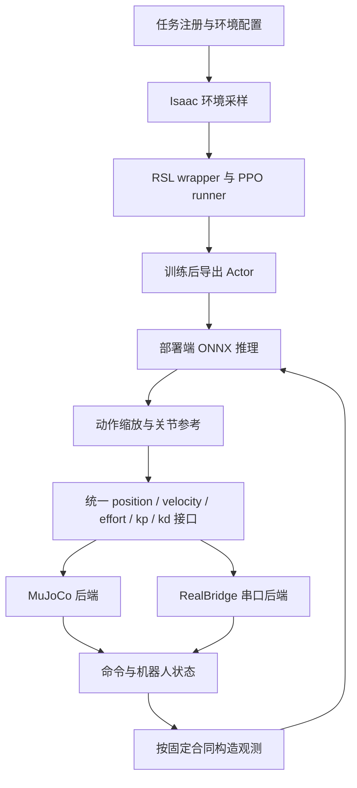

# 华南虎轮足训练与上位机部署开源分析

核对日期：2026 年 10 月 27 日。本文沿训练、策略导出、状态采集、观测构造、推理、下发和底层执行的顺序分析，并与 CLT-RL 当前直接关节位置策略对照。

结论先说：这份开源最适合借鉴的是**仿真和实机共用策略接口、底层 PD 与网络分频、逐项核对输入输出、用实测数据校准执行器和延迟**的工作方式。它的模型、35 维观测、关节顺序、PD 数值和电机接口不能直接代替本项目的 27 维策略合同。NX 的工作暂不加入气弹簧前馈。

## 1. 本次实际读了什么

文章是华南理工大学华南虎战队的[轮足步兵强化学习运动控制训练与部署框架开源](https://bbs.robomaster.com/article/1942489)。正文强调模型与系统辨识、奖励信号、数据分布以及部署延迟；这些是该团队的经验，不能直接当成本车已经验证的结论。

主要源码固定到以下提交，避免把本机旧副本与线上新版本混在一起：

| 对象 | 仓库及固定提交 | 本次核对范围 |
| --- | --- | --- |
| 训练 | [wheeled-legged_RL，1a26356](https://github.com/scutrobotlab/wheeled-legged_RL/tree/1a26356d6f591734d4f6f666f5cead1a6925da67) | train.py、任务注册、V14/V13/25v3 继承链、执行器、观测和动作延迟、随机化、PPO 配置 |
| 部署 | [wheelbipe_ros2_sim2sim，dd367bf](https://github.com/scutrobotlab/wheelbipe_ros2_sim2sim/tree/dd367bf78c7e393d811595edeb4affe253156c95) | Controller、FSM、35D 观测、ONNX 调用、RealBridge、串口、MuJoCo PD 和执行器模型、安装脚本 |
| 本工程 | CLT-RL 当前工作树 | `sim2real/jetson_nx/wheelleg_deploy`、`leg_control.py`、环境直接关节动作分支与当前部署要求 |

本机原有 `/home/aaa/studyRL/src/wheeled-legged_RL` 停在 `b8ff79f`。本次另取线上提交用于分析，没有覆盖旧副本或修改其训练数据。

文章另外引用了以下项目。本次只核对它们的项目入口和定位，没有声称逐文件审计这些仓库：

| 引用项目 | 对本项目有用的方向 | 使用边界 |
| --- | --- | --- |
| [robot_lab](https://github.com/fan-ziqi/robot_lab) | Isaac Lab 任务组织、机器人适配与训练配置 | 不能把其他机器人的动作含义和电机参数直接移入本车 |
| [DeepRoboticsLab/rl_training](https://github.com/DeepRoboticsLab/rl_training) | 训练任务与配置组织 | 先核对机器人构型、观测及执行器，再比较方法 |
| [TRON1 Isaac Lab](https://github.com/limxdynamics/tron1-rl-isaaclab) | 双足运动策略的训练与迁移流程 | 与本车闭链五连杆的机械约束不同 |
| [TITA RL](https://github.com/DDTRobot/tita_rl) | 轮足任务与仿真到实机的接口思路 | 不能替代本车的闭链、减速比和零点标定 |

文章还链接了两份模型导出飞书文档和一份网络实验文档。本次尝试访问时无法取得全文，因此没有据此补写建模步骤或实验排名。本文的具体数值和调用关系来自已经取得的源码。

文章标注 CC BY-NC-SA 4.0；两个核心代码仓库分别提供 MIT 许可，部署模型还附有独立资产许可。下面是独立的源码分析，不转载整篇文章。若以后实际复用其代码，应连同相应版权和许可保留；不能将文章许可与代码许可混用。

## 2. 先看整个框架怎样连起来



这里有两个独立的一致性问题。

第一，训练环境给 Actor 的观测，必须与部署端构造的观测具有相同顺序、零点、单位、裁剪和缩放。网络只看到数值，不知道某一列被错误地从 rad/s 换成了 rpm。

第二，训练时网络输出的动作，必须在部署端产生相同含义的参考。都是六个数并不代表兼容：四个腿角与两个轮速可以排列成不同顺序；相同的归一化值还可能对应不同角度幅值。

这两项都是我们 NX 接入需要落实的合同。是否使用 ROS 2 并不会自动解决它们。

## 3. 训练入口：先找任务，再找实际执行的函数

源码入口：[scripts/rsl_rl/train.py](https://github.com/scutrobotlab/wheeled-legged_RL/blob/1a26356d6f591734d4f6f666f5cead1a6925da67/scripts/rsl_rl/train.py)。

它的训练主线是：

```text
AppLauncher 启动仿真应用
  → 导入 agent_tasks，执行 gym.register
  → hydra_task_config 解析环境与 runner 配置
  → gym.make(task, cfg=env_cfg)
  → RslRlVecEnvWrapper
  → runner_class(env, agent_cfg.to_dict(), ...)
  → 可选检查点加载
  → runner.learn(...)
```

`AppLauncher`、Hydra、Gym 和 wrapper 是库接口。这里需要理解它们接收什么、返回什么以及何时调用，不需要为理解训练步骤展开 USD 或仿真启动器的内部实现。

项目应用逻辑则值得继续向下追。例如 `runner_class` 由配置选择；普通 runner 与自定义算法分支使用不同 wrapper。这样 DreamWaQ/HIM 所需的额外历史观测才有机会被正确传入算法，而不是被普通单输入路径丢掉。

### 3.1 任务名称怎样找到配置和环境

在 [V14 的 __init__.py](https://github.com/scutrobotlab/wheeled-legged_RL/blob/1a26356d6f591734d4f6f666f5cead1a6925da67/source/agent_tasks/agent_tasks/direct/wheelbipe/wheelbipe_V14/__init__.py) 中，`Robotics-Wheelbipe-V14-Flat-v0` 对应：

| 配置项 | 指向哪里 | 后续作用 |
| --- | --- | --- |
| `entry_point` | `WheelbipeV14Env` | 决定实例化哪个环境类 |
| `env_cfg_entry_point` | `WheelbipeV14FlatEnvCfg` | 决定机器人、动作、观测、命令、奖励和随机化 |
| `rsl_rl_cfg_entry_point` | `WheelbipeV14FlatPPORunnerCfg` | 决定 Actor/Critic 与 PPO 参数 |

因此不能只看一个 `env_cfg.py` 就断言所有平地、粗糙地形和 Play 任务都使用相同配置。不同任务会绑定不同子类，子类的 `__post_init__()` 还可能修改继承的值。

### 3.2 为什么只读 V14/env.py 会漏掉控制主线

环境继承链是：

```text
WheelbipeV14Env
  → WheelbipeV13Env
  → Wheelbipe25V3Env
  → DirectRLEnv
```

[V14/env.py](https://github.com/scutrobotlab/wheeled-legged_RL/blob/1a26356d6f591734d4f6f666f5cead1a6925da67/source/agent_tasks/agent_tasks/direct/wheelbipe/wheelbipe_V14/env.py) 的 `_apply_action()` 先调用 `super()._apply_action()`，然后处理云台和小陀螺相关逻辑；`_get_observations()` 同样先取父类结果，再记录轨迹。

真正的腿角、轮速目标和观测拼接主要在 [wheelbipe25_v3/env.py](https://github.com/scutrobotlab/wheeled-legged_RL/blob/1a26356d6f591734d4f6f666f5cead1a6925da67/source/agent_tasks/agent_tasks/direct/wheelbipe/wheelbipe25_v3/env.py)。分析调用关系时，遇到 `super()` 应继续沿继承链追踪，直到找到对数据作实际变换的位置。

## 4. 动作执行：它同样支持直接关节角，不要求策略输出 VMC 变量

在父环境的 `_pre_physics_step()` 中，应用逻辑依次完成：

1. 保存本次策略动作；若开启动作滤波，先通过滤波器。
2. `_split_policy_actions()` 按配置拆成腿部和车轮动作，同时核对维度。
3. `_decode_leg_policy_actions()` 将腿动作解码成关节参考。
4. 车轮动作乘 `wheel_action_scale` 得到轮速或力矩参考。

对于默认的 `raw` 腿角编码，核心关系是：

```text
leg_target = default_leg_position + leg_action_scale × leg_action
```

这里 `default_leg_position` 是对应主动关节的默认姿态，不是车身高度。动作缩放也不是连杆长度。换模型时如果默认姿态和主动轴方向变了，即使仍然使用六维 Actor，也不能沿用原来的映射。

接下来 `_apply_action()` 将腿角夹到上下限；若启用动作延迟，则先进入延迟缓冲，再通过 `set_joint_position_target()` 写入机器人。轮速分支对应 `set_joint_velocity_target()`；另一个配置分支才是直接 effort。

这几个 `set_joint_*_target()` 是库接口：输入为目标张量和关节索引，作用是设置执行器参考，返回值不是最终电机力矩。最终力矩还取决于选用的执行器。

### 4.1 执行器类型与我们不同

[wheelbipe_V14_2.py](https://github.com/scutrobotlab/wheeled-legged_RL/blob/1a26356d6f591734d4f6f666f5cead1a6925da67/source/agent_world/agent_world/assets/wheelbipe_V14_2.py) 中，当前启用的是 `IdealPDActuatorCfg`，不是注释中的 `ImplicitActuatorCfg`。基础主动腿参数为 Kp=60、Kd=2，轮子 Kp=0、Kd=0.2。

这说明：**输出关节角参考**与**仿真使用显式还是隐式 PD**是两个层面。策略可以输出关节角，再由显式执行器计算力矩；也可以把关节角交给隐式驱动。

本项目当前环境的 `_apply_direct_joint_position_action()` 则调用 `joint_position_targets()` 得到四关节目标，再写入 PhysX 隐式 PD，并另写重力前馈。后续 STM32 用 LK 电机电流接口执行 PD 时，需要核验离散响应，不能仅因 Kp、Kd 数字相同就宣称与 PhysX 等价。

### 4.2 PPO 网络并不比我们当前网络复杂

[rsl_rl_ppo_cfg.py](https://github.com/scutrobotlab/wheeled-legged_RL/blob/1a26356d6f591734d4f6f666f5cead1a6925da67/source/agent_tasks/agent_tasks/direct/wheelbipe/agents/rsl_rl_ppo_cfg.py) 的 V14 普通 Actor 隐藏层是 `[256,128,64]`，激活函数为 ELU，和我们当前 Actor 的隐藏层规模一致。输入合同不同，所以权重不能互换。

DreamWaQ、HIM、NP3O 是可选分支；它们需要配套观测和 runner，不是把算法名换一下就能用于现有检查点。当前没有证据要求为了串口部署而更换本车网络。

### 4.3 它区分了“真正续训”和“只加载权重”

`train.py` 中带 `--resume_training` 时走 `runner.load(..., load_optimizer=True)`，并恢复/推进 iteration。没有该标志的检查点路径走 `_load_policy_for_finetune()`：只匹配加载网络张量，将训练 iteration 置零。

这个区别对本项目尤其重要。我们已经要求保留优化器，后续若参考这个脚本，不能把默认的权重微调分支误叫作完整恢复。更不能把输入层扩展后的部分权重加载当作原策略无变化的回放。

## 5. 35 维观测：先逐列核对，再谈复用

公开部署端的实际构造函数是 [StateRL::buildObservation()](https://github.com/scutrobotlab/wheelbipe_ros2_sim2sim/blob/dd367bf78c7e393d811595edeb4affe253156c95/src/controllers/template_ros2_controller/src/fsm/states/state_rl.cpp)。它依次构造命令块、传感器块、上一动作块和固定模式块。

| 位置，0 起算 | SCUT 部署合同 | 本项目对应内容 |
| --- | --- | --- |
| 0–3 | 前进、保留横移、偏航速度、高度命令 | 本项目命令位于 6–8，没有横移命令槽 |
| 4–6 | 机体角速度，默认 ×0.5 | 本项目位于 0–2，比例取自身 bundle |
| 7–9 | 机体系投影重力 | 本项目位于 3–5 |
| 10–15 | 四腿位置及两个置零轮位置槽 | 本项目 9–12 只包含四腿位置偏差 |
| 16–21 | 四腿速度和两轮速度，默认 ×0.1 | 本项目分别位于 13–16、19–20 |
| 22–27 | 上一策略动作 | 本项目位于 21–26，并要求使用有效限幅后动作 |
| 28–34 | normal 模式及其他固定模式量 | 本项目没有这七列 |
| 无对应输入 | 此基础 Actor 没有显式机身 vx/vy 输入 | 本项目 17–18 是水平航向坐标系机身 vx/vy |

公开版尾部固定为 `[1,0,0,0,0,0,0]`。它不通过键盘切换成跳跃策略。训练仓库有多任务组件，不代表这个公开部署入口已经开放全部能力。

`buildObservation()` 中每个数据块先按部署参数处理，再拼接到统一向量。`last_actions_` 在实际发生推理并处理输出后更新；不推理的控制周期继续保持上次参考。这就是 50 Hz 网络、500 Hz 控制调度能一起工作的原因之一。

对于本项目，需要进一步区分网络原始输出、角度限位后的有效动作和真正收到的 MCU 参考。不能只把 NX 最后算出的六个原始数放进 last_actions，就认为符合训练时的历史动作语义。

两个方案都没有多帧传感器堆叠，但都存在上一动作输入。这里“没有历史帧”不表示整个闭环完全没有历史信息。

### 5.1 本项目最容易遗漏的观测是机身速度

本项目策略明确依赖水平航向坐标系的 vx/vy。轮胎打滑、抬腿、闭链运动和车体转动时，编码器轮速乘轮半径不能自动等同于这个量。

所以不能因为 SCUT 的基础观测没有这两列，就在本项目部署端删掉它们或固定填零。那会改变输入分布；正确处理是实现并验证与训练定义一致的状态估计，或另行训练不依赖这些输入的策略。当前不能跳过这个差异。

本项目合同见 [schema.py](../../../sim2real/jetson_nx/wheelleg_deploy/schema.py)；角目标与有效动作回算见 [leg_control.py](../../wheel_legged_gym_isaaclab/leg_control.py)。

## 6. 域随机化和延迟：要看生效代码，不能只看注释

V14 基础配置实际写入 `events = EventCfgV14()`，还定义传感器噪声和观测/动作延迟。附近的“temporarily disable”注释不足以证明这些功能关闭。

`EventCfgV14` 包括机身、腿和轮质量，质心，接触摩擦，关节摩擦，执行器增益及力矩输出比例等扰动。部分候选项随后明确赋值为 `None`，例如惯量事件；因此也不能把所有出现过的 EventTerm 都算作有效随机化。具体 Play 子类还会覆盖其中部分事件。

这对我们的启示是：将“设计了某项随机化”与“本次实际运行启用了某项随机化”分别记录。当前本车需要的机身 ±2 kg，应按本车名义质量和质量分配配置，不能照抄别人按比例随机化的范围。

### 6.1 延迟缓冲为什么放在物理子步

父环境初始化时，为 `root_ang_vel_b`、`projected_gravity_b`、`joint_pos`、`joint_vel` 建立各自的 `DelayBuffer`。`_apply_action()` 每次物理动作更新时推进相应路径，`_update_obs()` 处理传感器缓存，重置时重新抽取每个环境的 lag。

这样网络仍可保持 50 Hz，而延迟不必粗糙地只能设置成 0、20、40 ms。对电机与 IMU 分开设置，还可以表达两类传感器到达时间不同的情况。

### 6.2 当前源码的默认 lag 不是统一 20 ms

核对基础配置和 `_reset_idx()`，可以得到：

| 对象 | 配置 | `torch.randint` 实际取值 | 以基础 dt=5 ms 换算的缓冲 lag |
| --- | --- | --- | --- |
| 观测 | `[1,4]` | 1、2、3 步 | 5、10、15 ms |
| 动作 | `[1,3]` | 1、2 步 | 5、10 ms |

上界不包含在内。以上只是缓冲区名义 lag，不包含采样相位、主机调度、电机动态，也不是本次对真机测出的总延迟。

基础配置的 `sim.dt=1/200`、`decimation=4`，对应物理 200 Hz、策略 50 Hz。文章讨论的更高仿真频率和赛季实测延迟，不能直接替换这份代码的实际配置。

这也说明我们后续应测端到端延迟分布，再设计随机化；应分别保留恒定延迟、抖动、丢包、陈旧观测和连续失联这些情况。只提高串口波特率无法消除全部延迟。

## 7. 部署主线：每一个控制周期到底做什么

上层控制入口是 [TemplateRos2Controller](https://github.com/scutrobotlab/wheelbipe_ros2_sim2sim/blob/dd367bf78c7e393d811595edeb4affe253156c95/src/controllers/template_ros2_controller/src/template_ros2_controller.cpp)，状态机分为 INIT、IDLE、PREPARE、RL。

在 RL 状态下可按下面的顺序阅读：

```text
hardware.read()
  → 从 MuJoCo 或 RealBridge 得到关节与 IMU
  → RobotState::run() 更新机体状态
  → StateRL::run()
       → buildObservation()
       → shouldInfer() 判断是否到了 50 Hz 时刻
       → setRLInput() / getRLOutput()
       → 动作滤波、缩放、更新上次动作与目标
       → applyLowlevelControl()
  → writeControllerCommands()
  → hardware.write()
```

`RobotState::run()` 把 IMU 数据转成旋转矩阵和姿态；`buildObservation()` 用世界单位重力方向和 world-to-body 旋转矩阵得到 projected gravity。这里需要的是方向，不是带线加速度的原始加速度计读数。

`shouldInfer()` 保存上次推理时刻，时间间隔达到 `1/inference_frequency_hz_` 才发起下一次网络计算；其余周期保持目标。控制器频率 500 Hz 与 Actor 频率 50 Hz 因而不矛盾。

PREPARE 负责从当前状态到预备姿态；退出 RL 会清理策略历史与缓冲。这样的模式转换值得借鉴，但它的预备关节零位属于另一台车，不能直接用于我们的 LK 编码器。

### 7.1 ONNX 调用是 CPU 同步推理

[ONNXRuntimeInference](https://github.com/scutrobotlab/wheelbipe_ros2_sim2sim/blob/dd367bf78c7e393d811595edeb4affe253156c95/src/controllers/template_ros2_controller/src/onnxruntime/onnxruntime_inference.cpp) 检查单输入输出、名称、float32 类型以及 `[1,35] → [1,6]` 的静态 shape，并将内部线程数设为 1。

`setInput()` 随后直接执行 `runLocked()`，后者调用 `session_->Run()`；不是只将数据投递给一个会自动保证截止时间的后台实时服务。较慢的一次推理仍可能延长当前控制调用，需要测量整体周期。

因此，对我们的约 4.9 万参数 MLP，先测试 CPU 推理耗时和抖动是合理的工程选择。是否使用 NX GPU 应由板上实测决定，不需要因为存在 CUDA 就默认增加 GPU 调度链路。

## 8. PD 到底在哪里算：继续追到写出的字段

`StateRL::applyLowlevelControl()` 计算腿部 PD，轮子则根据 `lowlevel_output_mode` 分支处理。但读到这里还不能断言这些 PD 力矩都会作为 effort 发下去，必须继续读 `writeControllerCommands()`。

默认 `hardware_pd_vel` 下，最终接口大意是：

| 对象 | position | velocity | kp / kd | effort 的主要用途 |
| --- | --- | --- | --- | --- |
| 四主动腿 | 网络给出的关节角参考 | 0 | 腿部位置 PD 增益 | 完整力矩限幅所需修正等 |
| 两轮 | 0 | 网络给出的轮速参考 | kp=0，kd 为轮速增益 | 完整力矩限幅所需修正等 |
| 两弹簧接口 | 保留在上层接口中 | 非策略动作 | 按对应配置 | 不占六维策略动作 |

`writeControllerCommands()` 在硬件 PD 分支并没有再把上层计算的整套腿 PD 原样叠成一份前馈。它会估计 `PD + effort`，在超过输出边界时通过 effort 修正总量。

这一步的意义是避免把“下位机 PD”和“上位机算好的同一份 PD”重复相加。对本车来说，NX 应输出约定好的参考，STM32 用本地新状态运行一套 PD，并统一处理前馈和最终力矩边界。

注意上位机根据旧反馈算出的限幅修正，不能代替 MCU 根据本地实际状态再次限幅。串口往返期间误差和速度会变化，完整输出仍需在真正执行的位置限制。

本项目对应的目标关系是：

```text
NX：27D 观测 → Actor → 有界参考请求
STM32：本地关节 PD + 训练合同中的重力前馈 → 总力矩限幅 → 电流/CAN
```

这一阶段不在 NX 中增加气弹簧前馈。它与已在训练合同中的重力前馈是两个不同来源，不能顺便将后者删除或把动作换回 VMC/IK。

## 9. MuJoCo 后端：同接口之外，还建立了执行器动态

[MujocoSystem::write()](https://github.com/scutrobotlab/wheelbipe_ros2_sim2sim/blob/dd367bf78c7e393d811595edeb4affe253156c95/src/interfaces/mujoco_bridge/src/mujoco_system.cpp) 从同样的五个命令字段构造：

```text
requested_effort = kp × position_error
                 + kd × (velocity_target - velocity)
                 + effort_command
```

然后做有限值检查、边界处理和执行器动态变换，再写入 MuJoCo。它使用物理 timestep 推进执行器模型，而不是假设每次调用 period 都等于正确的电机积分步长。

对应 Xacro 还设置腿部响应时间、传输延迟、速度下垂、变化率上限等参数。这里最值得借鉴的是：**把参考转换成电机响应的过程也纳入模型**，而不只拟合静态 Kp、Kd。

这些是另一台车的参数。比如其中 14 ms 时间常数、50 Hz 自然频率和速度下垂曲线，不能作为我们的 LK 电机辨识结果。未来应给同一组参考，让真机与仿真记录 q、dq、参考和力矩/电流，再用曲线差异定位动态误差。

### 9.1 弹簧的物理建模与软件前馈不是一回事

它在 Isaac 环境中对弹簧滑动关节施加力，在 MuJoCo 后端也有气弹簧物理模型。这些描述的是机器人本身的被动力。

公开串口包虽保留 `spring_compensation_scale` 字段，但 `RealMsgCommand packet{}` 先零初始化，公开桥接没有给这些保留量赋非零值。不能据这个字段名就声称上位机已经启用了气弹簧补偿。

因此，您的“上位机先不管气弹簧前馈”可以落实为不上发额外弹簧补偿。以后若实物安装气弹簧，仿真中是否需要体现这份真实被动力，是另一个建模问题，应单独评估。

## 10. 串口协议：可以参考组织方式，不能只复制结构体

协议定义：[real_msg.hpp](https://github.com/scutrobotlab/wheelbipe_ros2_sim2sim/blob/dd367bf78c7e393d811595edeb4affe253156c95/src/interfaces/real_bridge/include/real_bridge/real_msg.hpp)。接收和发送实现：[real_bridge.cpp](https://github.com/scutrobotlab/wheelbipe_ros2_sim2sim/blob/dd367bf78c7e393d811595edeb4affe253156c95/src/interfaces/real_bridge/src/real_bridge.cpp)。

| 项目 | 实际定义 | 理解重点 |
| --- | --- | --- |
| 命令包 | 158 字节 | 六个关节，各包含 position、velocity、effort、kp、kd |
| 状态包 | 143 字节 | 六关节状态、IMU、普通 DT7 与时间字段 |
| 帧头 / 帧尾 | A8 E6 / C3 F7 | 用于从字节流找帧，仍需要校验 |
| 布局 | 1 字节紧凑对齐 | MCU 必须匹配字段宽度、字节序和 float 表达 |
| CRC | 初值 FFFF，实际源码为右移并异或 8005 | 不应直接替换为名称相似的其他 CRC16 实现 |
| 默认串口 | 2 Mbaud，8N1 | 不是网络推理或 MCU PD 的运行频率 |

本次实际编译了该头文件的静态大小检查，并对同一 CRC 实现作 Python/C++ 对照：输入 ASCII `123456789` 得到 `0x3D7B`。这验证了本次读到的算法，不能拿一个默认 Modbus CRC 库替换它而不比对测试向量。

### 10.1 receive_packets() 怎么处理字节流

它先把串口读到的字节追加到缓存，再搜索帧头。缓存够一个状态包后，同时核对帧标记、字段有限性和 CRC。成功则保存最新状态，失败则前移一个字节继续找帧。

这样一次读操作可以包含半包、多包或错位数据，不要求操作系统每次 read 都恰好返回一个完整结构体。`latest_state_` 表示最新接受的状态，而 `last_valid_packet_us_` 记录本机接收时刻。

初始未收到有效包时，`write()` 不发送命令；状态超时后也禁止输出。这些行为比“串口已打开便不断下发”更适合作为部署基础。

### 10.2 有效 CRC 不等于状态是新的

接收路径校验了格式和有限值，但本次未看到依据递增序号或严格单调 MCU 采样时间拒绝重复帧的逻辑。时间字段被保存、回传，不等于已经参与防陈旧检查。

因此，若发送端持续重发旧数据，包可能仍通过格式检查并刷新接收时间。这是从源码得到的需要补足的边界，不代表本次已经在其真机重现故障。

我们的 NX/STM32 合同应区分：采样时间、接收时间、动作对应的状态序号、MCU 重启会话和实际应用的动作。MCU 还应有本地命令看门狗；主机停止发送不能保证旧目标自动失效。

### 10.3 同样是串口，理论传输时间也不能忽略

以下按该项目的 143/158 字节包、8N1 计算，**属于理论线速，不是实测延迟**：

| 波特率 | 状态包串行发送 | 命令包串行发送 | 对同一新状态作响应时，两段串行时间之和 |
| --- | ---: | ---: | ---: |
| 115200 | 12.413 ms | 13.715 ms | 26.128 ms |
| 921600 | 1.552 ms | 1.714 ms | 3.266 ms |
| 2000000 | 0.715 ms | 0.790 ms | 1.505 ms |

串口可以全双工，持续带宽应分方向算，不能将两个方向简单合成一个利用率。但同一状态先到 NX、随后才计算并返回响应，这条因果链确实包含两段传输时间。

在 2 Mbaud、每方向 500 Hz 下，状态和命令方向的线速占用分别约 35.75% 和 39.50%；系统调度、USB 桥接、缓存和 MCU 工作还会另外贡献延迟。我们的消息大小与收发频率应独立预算，不必照搬这套较大的包。

## 11. 几处不能直接照搬的代码和数值

### 11.1 安装流程面向 x86_64

[check_env.sh](https://github.com/scutrobotlab/wheelbipe_ros2_sim2sim/blob/dd367bf78c7e393d811595edeb4affe253156c95/scripts/check_env.sh) 明确检查 x86_64；[bootstrap.sh](https://github.com/scutrobotlab/wheelbipe_ros2_sim2sim/blob/dd367bf78c7e393d811595edeb4affe253156c95/scripts/bootstrap.sh) 下载 Linux x64 ONNX Runtime 和 x86_64 MuJoCo 包。

所以这个仓库可以借鉴上位机架构，但现成安装脚本不能原样作为 NX 的 ARM 部署包。需要匹配 NX 系统与 ABI 的运行库，再进行实际推理和串口周期测试。本次没有在 NX 上运行这些代码。

### 11.2 坐标变换是另一块 IMU 的约定

RealBridge 中接收四元数后存在 x/y 分量重排与符号变换。它不是所有轮足机器人都通用的 IMU 修正公式。

本车应从实际安装方向、INS 输出定义和仿真 base 坐标系推导变换。至少逐轴验证水平重力、正向 roll/pitch/yaw、四关节正方向和两轮前进方向；不能复制别人一行 quaternion 变换就视为校准完成。

### 11.3 六维动作的顺序不同

| 合同 | 六维动作排列 |
| --- | --- |
| SCUT 公开版 | 四腿关节在前，两轮在后 |
| 本项目 | LB、LL、左轮、RB、RL、右轮 |

本车四腿参考要提取 `[0,1,3,4]`，轮速要提取 `[2,5]`。通信层可以重新组织字段，但不能悄悄改变网络输出解释。

### 11.4 力矩上限必须沿完整链路核对

SCUT 的基础训练资产中主动腿 effort_limit=40 Nm、轮子=5 Nm；公开部署参数的输出边界为腿 50.9 Nm、轮 9.99 Nm，而 MuJoCo Xacro 又有自身边界。不同层可能用于不同配置或限制，不能只挑某个值就当成统一硬件能力。

本车已经确认的输出接口与限制应继续按自己的校准：腿部 35.574 Nm，轮子 4.80944 Nm。NX、STM32、电流转换和仿真记录应分别说明限制施加的位置，不能只限制单独的前馈再把它称作 PD+前馈总限幅。

### 11.5 一键切换后端不等于完成实车验证

`backend=sim|real` 将同一控制器接到两个硬件插件，是很有价值的软件结构。它证明接口可以共用，不能证明电机带宽、观测估计、实际惯量与摩擦已经对齐。

同理，键盘能控制 MuJoCo 是迁移链路的一部分；还需要定量轨迹、不同命令、重置与故障处理、延迟和执行器校准数据来支持可靠性结论。

## 12. 对本项目接下来的具体取舍

采用的方向：

1. **冻结一套策略合同。** 明确模型哈希、27 列观测、六维动作顺序、角度零点、尺度、总力矩边界和控制周期；训练和部署用同一份来源。
2. **仿真与串口共用上层逻辑。** 命令处理、观测构造和 Actor 推理只维护一份，后端负责状态来源和参考去向。
3. **网络与底层控制分频。** 维持已训练的 50 Hz 策略语义，STM32 用本地状态执行高频 PD；离散响应差异需要测量。
4. **从输入输出排查 gap。** 同一批记录先比观测，再比 Actor 输出，再比有效参考，最后比 q/dq 和整车响应，避免直接归咎于 reward。
5. **将辨识与鲁棒性分开。** 名义模型先尽量符合实物，再用参数和延迟扰动测试边界；不要用极宽随机化掩盖单位或符号错误。

不直接采用的内容：35D 模型、固定模式尾部、SCUT 的预备姿态、其电机 PD/限幅数值、其 IMU 变换和 x86 安装包。当前也不因为它提供复杂算法，就更换我们已经训练的 Actor。

当前任务顺序仍按用户最新要求：NX＋STM32 `(2)` 串口代码与离线数据链路先行，再做鲁棒性诊断。保留全部检查点和优化器；没有通过的 10% 验收项继续如实记录。上位机气弹簧前馈暂不加入。

## 13. 本次实际核对结果及边界

核对记录见 [06_华南虎源码核对记录.json](06_华南虎源码核对记录.json)。

已完成：固定两个仓库提交；读取上述调用链；对取得的 161 个文本源码/配置文件记录哈希；编译协议布局和 CRC；编译原始 `real_uart.c` 并用 POSIX 伪终端测试双向字节一致；核对延迟抽样上界和线速预算。

伪终端核对只证明本机软件的字节收发，不是物理串口、完整 RealBridge 解析器、STM32 执行或机器人运动测试。本次没有启动 Isaac、MuJoCo、NX 策略推理或实机电机，也没有将 SCUT 参数写入本车训练配置。三份飞书文档全文仍未取得。

这份分析支持接下来的接口设计与差异排查，不构成本车 sim2real 已经通过的结论。
